# AWS Practical Laboratory Report

**Student Name:** Kinley Palden

**Student ID:** 02230287

**Course:** DSO303

**Lab Number / Title:** Lab 03: Amazon EC2 and Deploying the USMS Application

**Date:** 2026-10-13

---

## 1. Aim / Objective

To deploy the University Student Management System (USMS) as a two-tier application on Amazon EC2 using the AWS CLI. The web server `usms-web-01` was launched into Lab 02's public subnet, with Lab 02's application security group and Lab 01's instance profile, from a reviewable `--cli-input-json` request. It was bootstrapped with user data, given a stable Elastic IP and an EBS data volume. A database-tier instance `usms-db-01` went into the private subnet. The lab then proves, from the API rather than by assumption, which addresses survive a stop/start, that the compute layer survives a Floci restart, and that a golden AMI can be captured for later labs.

---

## 2. Introduction

Amazon EC2 (Elastic Compute Cloud) provides resizable virtual machines, called **instances**, inside a VPC. Every instance is assembled from a small number of independent parts:

- **AMI:** a regional, immutable template for the root disk.
- **Instance type:** the hardware shape. `t3.micro` is 2 burstable vCPUs and 1 GiB of memory.
- **Network placement:** a subnet, which fixes the Availability Zone, plus one or more security groups.
- **Identity:** an IAM **instance profile**, through which the instance receives auto-rotated temporary credentials with no keys on disk.
- **Bootstrap:** optional **user data**, a script cloud-init runs once, as root, at first boot.
- **Storage:** **EBS** volumes, which are network block devices with their own lifecycle, independent of the instance.

**Elastic IPs** provide a public address that belongs to the account rather than to an instance, and an AMI can be captured from a configured instance so the next launch is a copy instead of a rebuild. EC2 is the foundation most other compute services build on, and understanding exactly which property belongs to the instance, its subnet or its VPC is what makes a deployment debuggable.

This lab ran against **Floci 1.7.0**. Unlike earlier builds, it backs each instance with a real `amazonlinux:2` Docker container, so user data genuinely executed. That made several real-AWS behaviours observable, and several emulator gaps visible, which are recorded throughout.

---

## 3. Use Case

EC2 is used wherever an application needs full control of its operating system and runtime:

- web and application servers behind load balancers,
- self-managed databases and caches,
- batch and build workers,
- legacy software that cannot be containerised,
- "golden image" fleets launched by Auto Scaling groups.

Typical examples include a university portal on a fleet of web servers spread across Availability Zones, a reporting server in a private subnet that only the application tier can reach, and a bastion or maintenance host launched for a task and then terminated.

In this lab USMS was deployed exactly that way:

- a public **web tier** (`usms-web-01`, and a second web server `usms-web-02` in the other AZ) that reaches S3 through an instance profile, with no credentials on disk;
- a private **data tier** (`usms-db-01`) that accepts PostgreSQL only from the web tier's security group and has no public address;
- a **golden AMI** that Lab 08 will use in a launch template.

---

## 4. System Architecture / Design

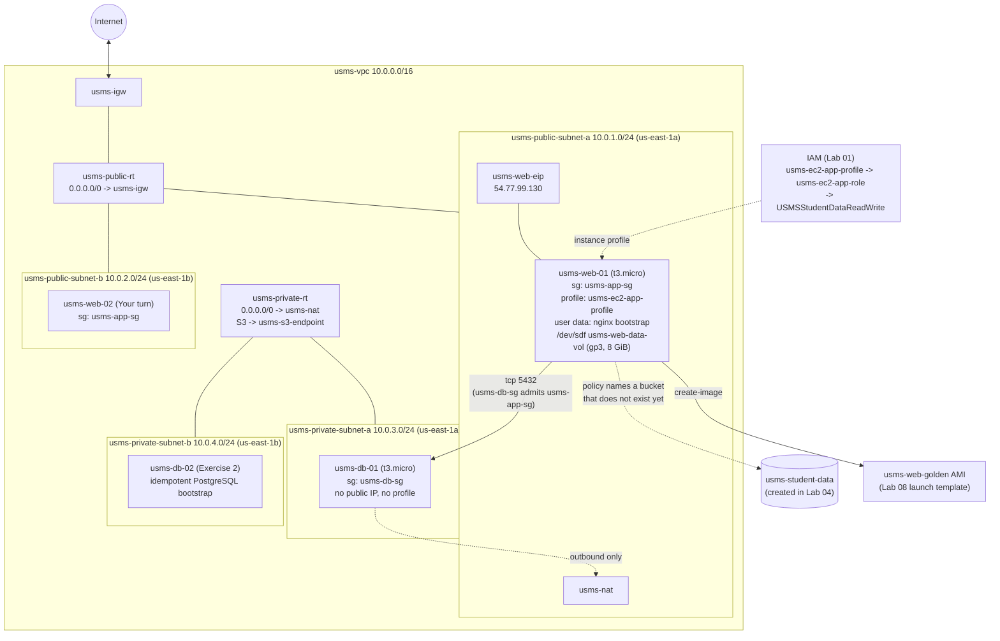

*Image Source: Mermaid diagram authored for this report from the lab's Section 5 architecture.*

---

## 5. Implementation Procedure

All commands were run with AWS CLI v2.36 against Floci's endpoint (`http://localhost:4566`) from `aws-floci-course/`, continuing from the Lab 01 and Lab 02 environments. Because shell variables die with the terminal, every ID was either captured into a variable and later re-derived by lookup into `configs/lab-03.env`, or read back from the API.

 

#### Prerequisite: close the two gaps left by Lab 02

Lab 03 assumes Lab 02 is complete including Exercise 5, and that `verify-lab-02.sh` reports `FAIL=0`. Neither was true:

- `configs/lab-02.env` held `USMS_PRIVATE_SUBNET_B=None`.
- `scripts/utilities/verify-lab-02.sh` had never been written.

I created `usms-private-subnet-b` (`10.0.4.0/24`, `us-east-1b`, `MapPublicIpOnLaunch=False`) and associated it with `usms-private-rt` and `usms-private-nacl`. I then wrote `verify-lab-02.sh` in the same style as the Lab 03 verifier, covering the VPC, IGW attachment, all four subnets, routing, both security groups, the NACL, NAT, the S3 endpoint and the env file. I also wrote the matching `lab-02-cleanup.sh`, which is not run.

 

#### Step 1: Resume the environment and load three env files

Brought Floci up with `floci-up.sh` and sourced `course.env`, `lab-01.env` and `lab-02.env`. `whoami.sh` reported account `000000000000`, and all six inputs Lab 03 consumes were non-empty: public subnet a, private subnet a, both security groups, the instance profile and AZ a.

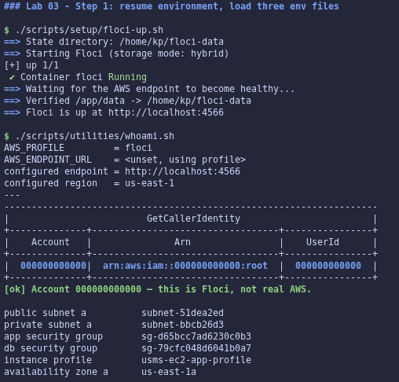

 

#### Step 2: Confirm Lab 02's network is intact (Checkpoint 1)

`verify-lab-02.sh` reported `PASS=36 FAIL=0`.

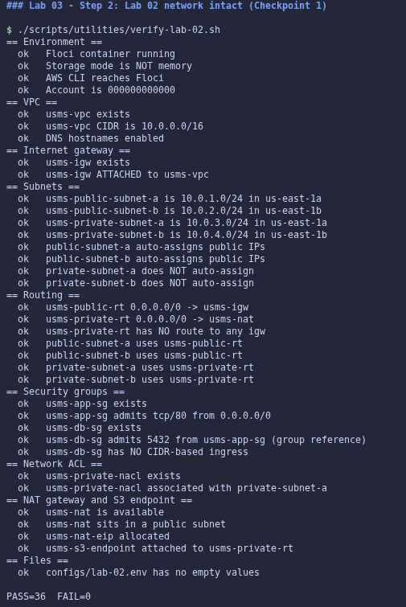

 

#### Step 3: Choose an AMI

`describe-images --owners amazon` listed five seeded images. `Images[0]` resolved to `ami-0abcdef1234567890` (`amzn2-ami-hvm-2.0.20230404.0-x86_64-gp2`), so neither fallback option (register-image or placeholder) was needed. The SSM public-parameter technique returned `ParameterNotFound`, which is the documented Floci limitation.

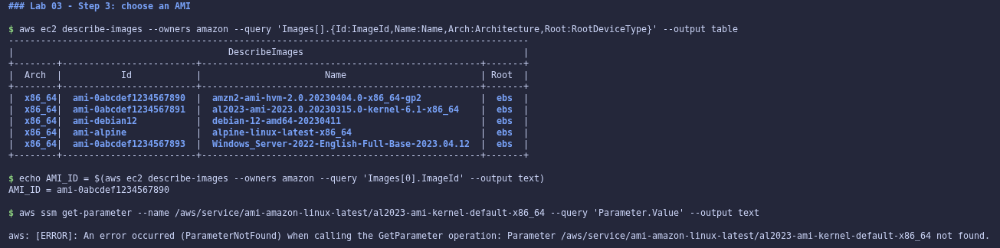

 

#### Step 4: Create the key pair and store the private key safely

Created `usms-app-key` with the private key redirected straight into `outputs/usms-app-key.pem`, so it never appeared on screen. Then `chmod 600` was applied, and `ls -l` confirmed `-rw-------`. The first line begins a PEM block, and `describe-key-pairs` returns the name and fingerprint but never the private key.

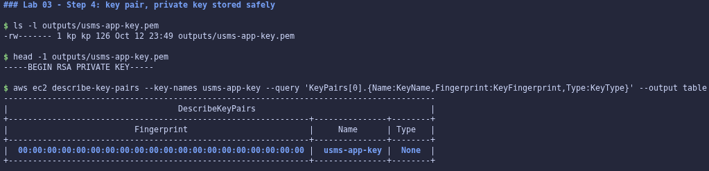

 

#### Step 5: Prove the private key is git-ignored

`git check-ignore -v outputs/usms-app-key.pem` named the matching rule (`.gitignore:22:*.pem`; `outputs/*` on line 7 also covers it). `git ls-files outputs/` listed only `outputs/.gitkeep`.

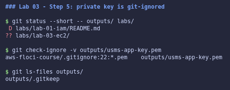

 

#### Step 6: Write the user-data bootstrap script

Wrote `labs/lab-03-ec2/user-data.sh` with a **quoted** outer heredoc, so `$TOKEN`, `${INSTANCE_ID}` and `$(date)` were written literally for evaluation on the instance. `bash -n` passed, and the script is 1,657 bytes, far below the 16 KB limit.

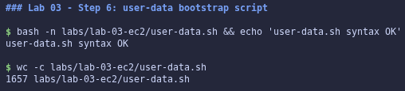

 

#### Step 7: Generate a request skeleton and fill it in

`--generate-cli-skeleton` produced a 230-line skeleton (kept out of Git). The real request, `templates/lab-03-run-instances.json`, was written with an **unquoted** heredoc so the four IDs expanded immediately. `python3 -m json.tool` confirmed it is valid JSON, and no `$` remained in the file.

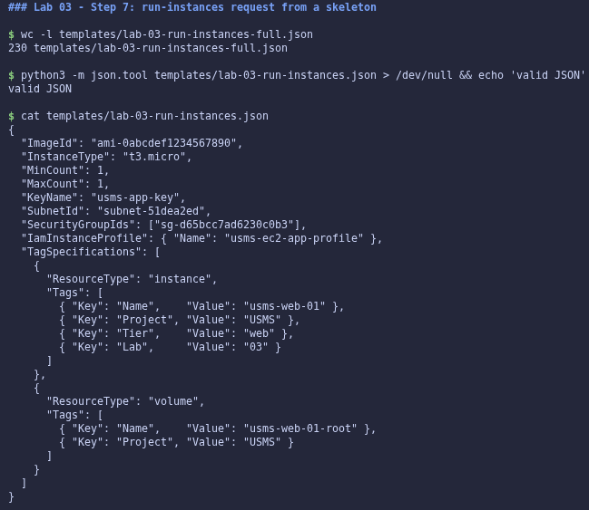

 

#### Steps 8-9: Launch the web server and wait for `running`

`run-instances --cli-input-json file://… --user-data file://…` returned `i-b617e94be1c24637e`. The `instance-running` waiter did **not** return in seconds as the lab predicts for Floci: Floci 1.7 first pulled `public.ecr.aws/amazonlinux/amazonlinux:2` (about 7 minutes, with one transient pull failure) and then started a real container for the instance. The manual polling loop from Step 9 confirmed the transition from `pending` to `running` once the pull completed.

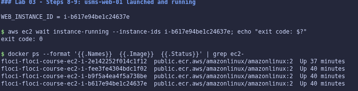

 

#### Step 10: Read the instance back (Checkpoint 2)

The instance is `running` as `t3.micro` in `us-east-1a`, in `subnet-51dea2ed` (= `$USMS_PUBLIC_SUBNET_A`), with `usms-app-sg`, key `usms-app-key`, and a non-null profile ARN `…:instance-profile/usms-ec2-app-profile`. Two values differ from real AWS because the instance is a Docker container:

- `PrivateIP` is `172.19.0.3`, a Docker bridge address, not an address in `10.0.1.0/24`.
- `PublicIP` is `127.0.0.1`.

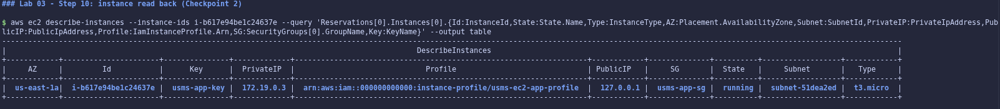

 

#### Step 11: Trace the permission chain

Followed the chain link by link: instance → `usms-ec2-app-profile` → `usms-ec2-app-role` → `USMSStudentDataReadWrite`. The policy document, saved to `outputs/lab-03-instance-policy.json`, does three things:

- allows `s3:ListBucket` and `s3:GetBucketLocation` on `arn:aws:s3:::usms-student-data`;
- allows `GetObject`, `PutObject` and `DeleteObject` on `…/usms-student-data/*`;
- explicitly denies `s3:DeleteBucket`.

The bucket does not exist until Lab 04, and this is valid because IAM policies are statements about ARNs (recorded in `notes/lab-03-notes.md`).

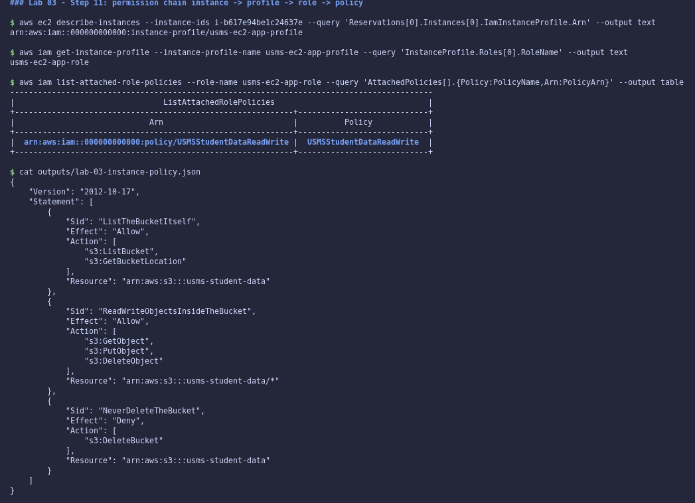

 

#### Step 12: Prove the user data arrived (Checkpoint 3)

The lab's API round-trip could not work on this build: `describe-instance-attribute --attribute userData` returns an empty attribute (`None`), so the decoded file was garbage and `diff` reported a mismatch.

Investigating the instance's container showed that Floci *does* deliver user data: it writes the script to `/tmp/user-data.sh` and executes it. I therefore proved it from that end instead. `docker exec … cat /tmp/user-data.sh` was compared with the source:

- both files are 1,657 bytes;
- `diff` is empty;
- the SHA-256 hashes are identical (`cb71915b…62e5`).

> `USER DATA PROVEN: what the instance received is byte-identical to what you wrote`

This proves more than the API round-trip would (delivery to the machine, not just storage), but it is a different proof, and it is recorded as such.

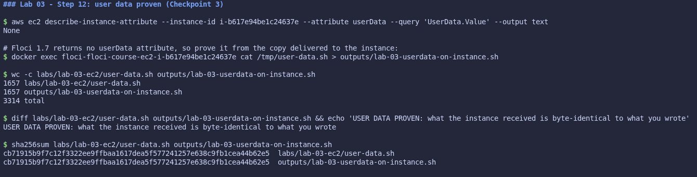

 

#### Step 13: Give the web server a stable public address

Allocated `usms-web-eip` (`eipalloc-44a8fc7ba9dd9aab2`, `54.77.99.130`) and associated it with `usms-web-01` (`eipassoc-1d769b1eacd2af87b`). `describe-addresses` shows the association correctly. Floci, however, keeps reporting `PublicIpAddress: 127.0.0.1` on the instance instead of switching it to the Elastic IP (a Floci limitation).

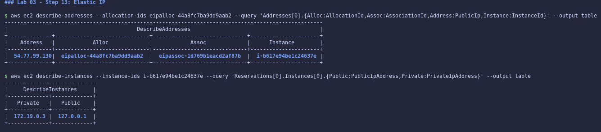

 

#### Step 14: Test the application (Checkpoint 4)

`curl` to the Elastic IP timed out after 5 seconds, as expected, because the address is not routable. All six configuration checks answered with a non-null value:

1. `running`
2. `igw-b72d7607`
3. `available`
4. `0.0.0.0/0`
5. a public address
6. `acl-c9ffabd77a6f40ee4 True`

The seventh link, a process listening on port 80, was not merely unobservable. Reading the instance's own log (`/var/log/usms-bootstrap.log`) showed it **failed**: `dnf: command not found`. The Amazon Linux 2 image ships `yum`, not `dnf`, so nginx was never installed. The IMDS `curl` then hung, because Floci could not install its IMDS proxy into the container. This is the lab's "Known issue on Floci 2.0.1" reproduced on 1.7.0, and it is exactly the class of fault the six configuration checks cannot detect.

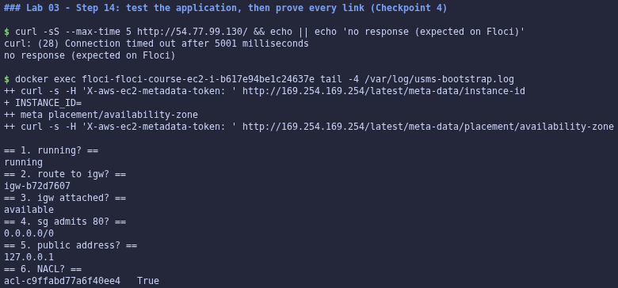

 

#### Step 15: Create and attach a data volume

Derived the AZ from the instance (`us-east-1a`), created `usms-web-data-vol` (8 GiB `gp3`, `vol-637fc932d3d68cd38`) there, and attached it at `/dev/sdf`. `describe-volumes` showed two volumes:

- the root volume `/dev/xvda`, with `DeleteOnTerm True`;
- the data volume `/dev/sdf`, with `DeleteOnTerm False`.

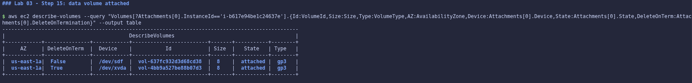

**Your turn (AZ constraint):** created an 8 GiB volume in `us-east-1b` and tried to attach it to `usms-web-01` in `us-east-1a`. Floci **refused** with `InvalidParameterValue: The volume … and instance … must be in the same Availability Zone`. Real AWS refuses the same request with the error code `InvalidVolume.ZoneMismatch`. The test volume was deleted afterwards.

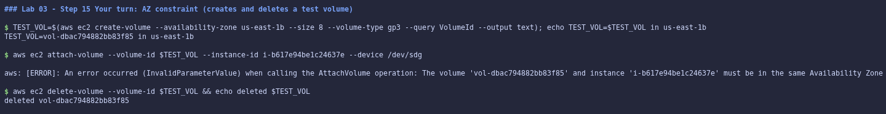

 

#### Step 16: Launch the database-tier instance into the private subnet

Launched `usms-db-01` (`i-b9f5a4ea4f5a738be`) with long-form flags, deliberately without `--iam-instance-profile`. The read-back shows:

- `Subnet` is `subnet-bbcb26d3` (`usms-private-subnet-a`);
- `Public` is `None`;
- `SG` is `usms-db-sg`;
- `Profile` is `None`, on purpose.

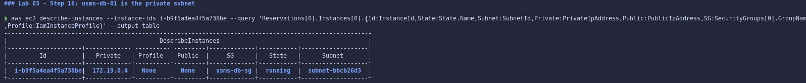

 

#### Step 17: Prove the two tiers are wired correctly (Checkpoint 5)

The web instance carries `usms-app-sg` and has a public address. The db instance carries `usms-db-sg` and has no public address. `usms-db-sg` admits port 5432 from `FromGroup sg-d65bcc7ad6230c0b3` with `FromCIDR None`:

> `WIRING PROVEN: usms-db-sg admits 5432 from sg-d65bcc7ad6230c0b3, which is the group usms-web-01 carries`

The private subnet's route table has only `local` and `0.0.0.0/0 -> nat-d532d2be2a65644d8`. That means outbound only, and no internet gateway.

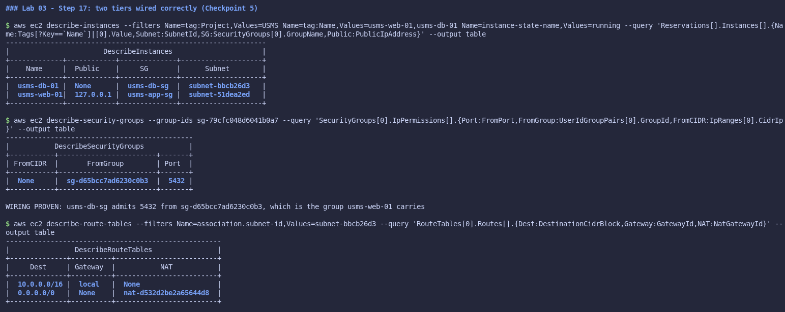

 

#### Step 18: Stop and start the web server

`stop-instances` moved the instance from `running` to `stopping`, but Floci never completed the transition: the `instance-stopped` waiter timed out, and the read-back showed `stopping` with `Public 127.0.0.1` still present. `start-instances` returned it to `running`.

- The private address (`172.19.0.3`) and instance ID were unchanged.
- The Elastic IP was still associated afterwards.
- The *release* of an auto-assigned address on stop was not observable, and is answered in prose in review question 4.

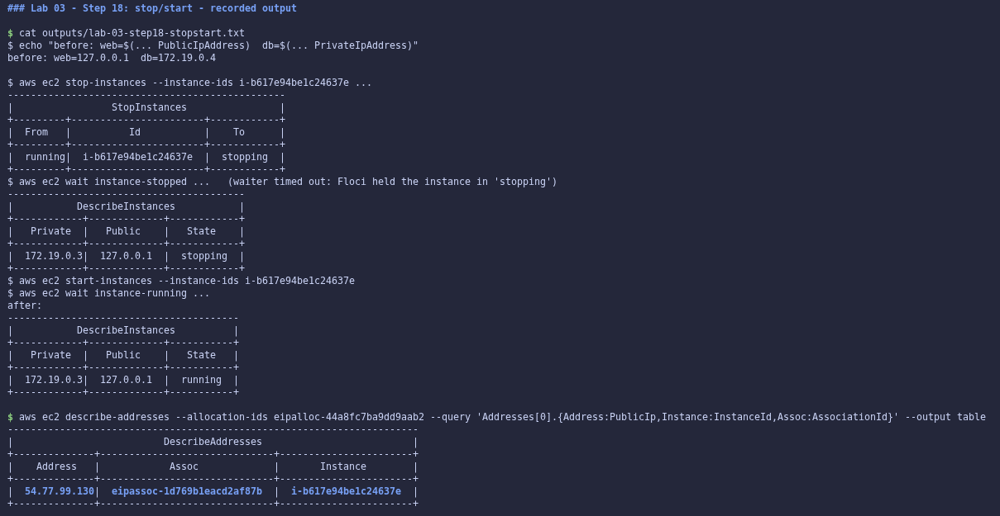

**Your turn:** copied the request to `templates/lab-03-run-instances-web02.json`, changing only `SubnetId` and the two `Name` tags (a three-hunk `diff`). This launched `usms-web-02` (`i-fee3fe4304bdc1f02`) in `usms-public-subnet-b`. A query filtered on `Tier=web` returns exactly two rows, in `us-east-1a` and `us-east-1b`, both with `usms-app-sg` and the same instance profile.

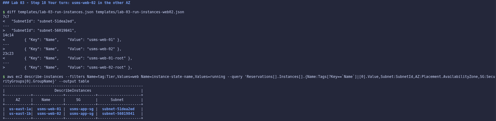

 

#### Step 19: Prove the compute layer survives a restart (Checkpoint 6)

The first attempt reported `PERSISTENCE FAILED`, for three separate reasons I diagnosed in turn:

1. **Instance records persisted, but run state did not.** `compose stop` kills the instance containers (exit 137), and Floci marks such instances `stopped` on boot, so the `instance-state-name=running` filter excluded them.
2. **Root volumes were never tagged.** Floci ignores `TagSpecifications` with `ResourceType=volume` on `run-instances`, and `create-tags` on a root volume lands in the tag store but not on the volume record. The `tag:Project` volume count was therefore 1 instead of 4.
3. **`usms-web-02` was killed mid-bootstrap by the restart.**

After restarting the instances, I re-ran the proof on a clean baseline:

- `outputs/lab-03-post-restart-records.txt` (no state filter) matched the pre-restart file exactly: **same instance IDs, subnets and security groups**.
- After `start-instances` brought all three back, the lab's own `running`-filtered query diffed clean:

> `PERSISTENCE PROVEN: same instances, same subnets, same security groups after restart`

Four volumes and two tagged Elastic IPs survived, and `usms-web-eip` was still associated with `usms-web-01`.

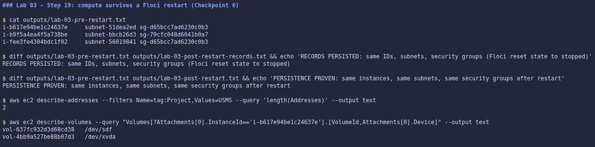

 

#### Step 20: Create an AMI from the configured instance (Checkpoint 7)

`create-image --no-reboot` produced `ami-5961a0a9437f4236f` (`usms-web-golden-20261012`). It is `available`, `Public False` and `Root /dev/xvda`. Floci returns `Tags: null` for the image even after `create-tags`, and it ignores `tag:` filters on `describe-images` (a filter on a non-existent name still returned the image).

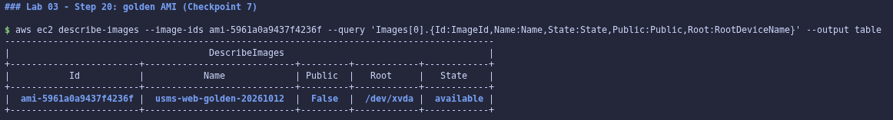

 

#### Step 21: Audit what this lab created

Instances, volumes, Elastic IPs and images were all listed. Each instance and the data volume carries a `Name`. Root volumes show `None` because of the Floci tagging limitation described in Step 19.

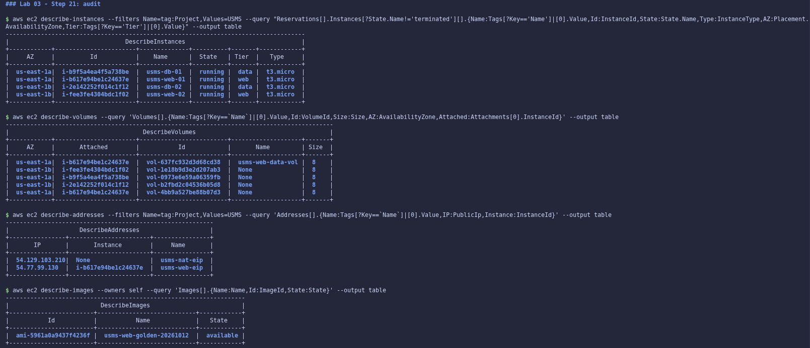

**Your turn (exposure report):** `sort_by()` cannot order `null` against a string, so the sort key was mapped to an orderable value with `&to_string(PublicIpAddress != null)`. `"false"` sorts before `"true"`, so instances without a public address come first. The output, saved to `outputs/lab-03-exposure-report.txt`, lists `usms-db-01 False` above `usms-web-01 True` and `usms-web-02 True`.

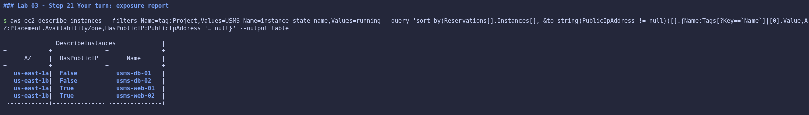

 

#### Step 22: Write `configs/lab-03.env`

The lab's tag-filtered lookups produced a **silent error**: `USMS_WEB_EIP_ALLOC` and `USMS_WEB_PUBLIC_IP` recorded the **NAT gateway's** Elastic IP (`eipalloc-a500…`, `54.129.103.210`). Floci ignores `tag:Name` filters on `describe-addresses` (a filter for a non-existent name returned both addresses), so `Addresses[0]` was simply the first address.

I rewrote the Elastic IP and AMI lookups to select by tag client-side with JMESPath (`Addresses[?Tags[?Key=='Name' && Value=='usms-web-eip']]`), which behaves identically on real AWS. The completeness check then printed `all values populated`, and the values are correct: `eipalloc-44a8fc7ba9dd9aab2` / `54.77.99.130`.

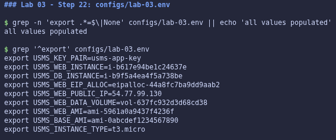

 

#### Step 23: Commit

Ran `git status --short` and `git check-ignore -v outputs/usms-app-key.pem` first, then staged by explicit path (including the Lab 02 gap-fillers and the Exercise files). Nothing under `outputs/` and not `templates/lab-03-run-instances-full.json` was staged.

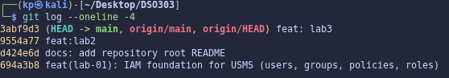

 

#### Section 8.1: `verify-lab-03.sh`

Built verbatim from the lab. Result: **`PASS=36 FAIL=0`**, including the three checks that go beyond existence:

- `usms-db-01 has NO public address`;
- `data volume DeleteOnTermination is False`;
- `private key is chmod 600 and not tracked by git`.

One caveat is recorded: `usms-web-01 has user data stored` passes because `test -n` accepts the literal string `None` that Floci returns. User data delivery was proven separately in Step 12.

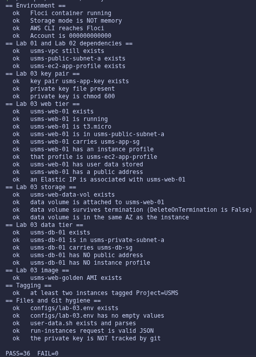

 

#### Section 8.2: `lab-03-cleanup.sh`

Built verbatim from the lab, guarded by typing `DELETE USMS COMPUTE`. `bash -n` reported `syntax OK - do NOT run it`. It was **not** run.

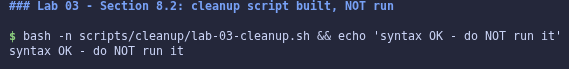

 

#### Independent exercises

All five are documented in full, with commands and outputs, in `labs/lab-03-ec2/exercises.md`:

1. `usms-admin-01-host` launched in `us-east-1b`.
2. An idempotent PostgreSQL bootstrap on `usms-db-02` in `usms-private-subnet-b`, with byte-identical user data and a demonstrated early exit on re-run.
3. `scripts/utilities/lab-03-reachability.sh`, giving identical output from two directories.
4. A right-sizing and cost analysis, plus the executed deletions, after which `verify-lab-03.sh` still reports `FAIL=0`.
5. The credential-free `transcript-upload.sh` and `outputs/lab-03-s3-readiness.txt`, which captures `head-bucket` 404 with exit 254.

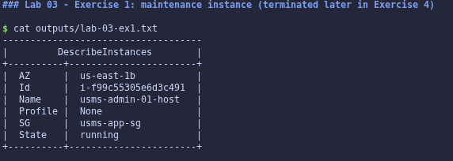
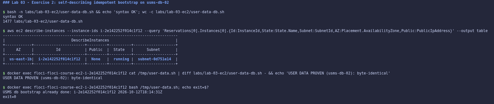
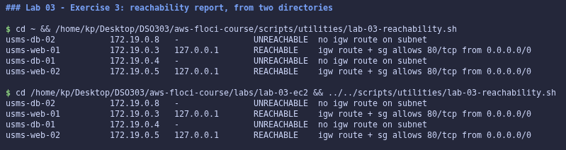
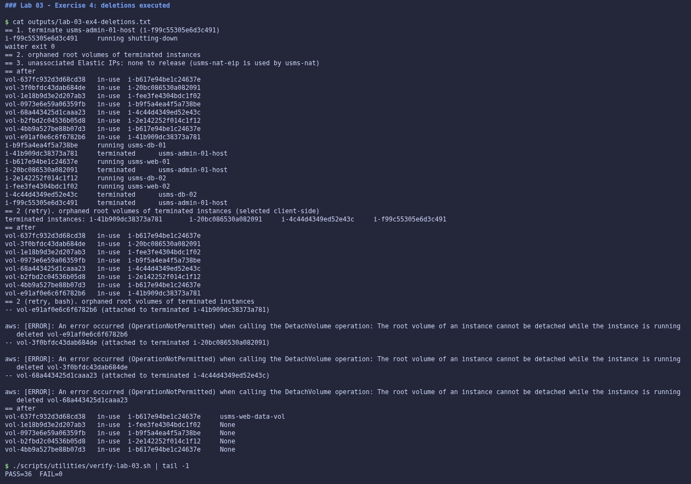
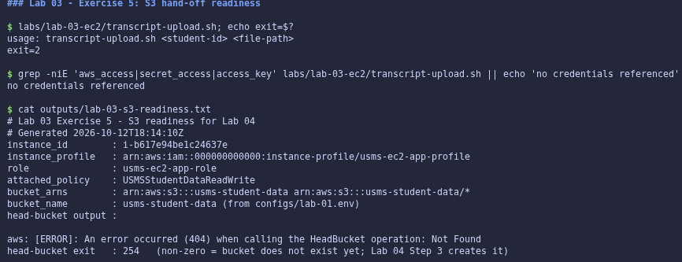

---

## 6. Results and Evidence

### 6.1 CLI Output

**Screenshot 1: user data proven byte-identical (Checkpoint 3, Step 12)**

*Image Source: `aws-floci-course/screenshots/lab3/s12.png`*

 

**Screenshot 2: two tiers wired by security-group reference (Checkpoint 5, Step 17)**

*Image Source: `aws-floci-course/screenshots/lab3/s17.png`*

 

**Screenshot 3: compute layer survives a restart (Checkpoint 6, Step 19)**

*Image Source: `aws-floci-course/screenshots/lab3/s19.png`*

 

**Screenshot 4: `verify-lab-03.sh` PASS=36 FAIL=0 (Section 8.1)**

*Image Source: `aws-floci-course/screenshots/lab3/s24.png`*

 

All screenshots referenced in Section 5 are stored in `aws-floci-course/screenshots/lab3/`.

### 6.2 AWS Console Verification

Not applicable. Floci is a CLI-only local emulator with no web console. All verification was performed through the AWS CLI (`describe-*`, `--query`, `--output table`), together with `docker exec` reads of the instance containers where Floci's API fell short.

---

## 7. Analysis and Discussion

All 23 steps, both "Section 8" scripts, the four "Your turn" tasks and all five exercises were completed. `verify-lab-02.sh` and `verify-lab-03.sh` both finish at `PASS=36 FAIL=0`. Every checkpoint was met:

- the web tier sits in the public subnet with the right group, profile and key, and its user data is proven;
- the data tier is private, profile-free, and admits only the web tier's group;
- the six reachability links answer;
- the records survive a restart;
- the golden AMI exists;
- `configs/lab-03.env` is fully and correctly populated.

The results did not always match the lab's expected output, because Floci 1.7.0 behaves differently from the build the lab was written for. The issues encountered and how each was resolved:

- **Lab 02 was not actually complete.** `USMS_PRIVATE_SUBNET_B=None`, and there was no `verify-lab-02.sh`. Resolved by creating `usms-private-subnet-b` with its route-table and NACL associations, and writing the verifier and cleanup scripts.
- **The first instance took about 9 minutes to reach `running`.** Floci 1.7 runs instances as real containers and had to pull the Amazon Linux 2 image first. Resolved with the lab's own manual polling loop.
- **User data could not be read back through the API.** Floci delivers and executes the script, but returns no `userData` attribute. Resolved by proving byte-identity against the copy inside the instance (size, `diff` and SHA-256), which is evidence of delivery rather than storage.
- **The bootstrap failed on the instance (`dnf: command not found`).** This is a genuine bug in the lab's script for an Amazon Linux 2 AMI, not just an emulator artefact, and the same failure would happen on real AWS. Exercise 2's script was written to detect the package manager for this reason.
- **The restart proof initially failed.** Diagnosed as three distinct Floci behaviours (run state reset to `stopped`, root volume tags never applied, one instance killed mid-boot). Resolved by separating "records persisted" from "state persisted", restarting the instances, and re-running the proof.
- **Floci's SSH port counter collided after the restart**, sending three launches to `terminated`. Resolved by retrying; the orphaned root volumes Floci left behind were cleaned up in Exercise 4.
- **The most important one: a silent wrong value.** Floci ignores `tag:` filters on `describe-addresses`, so `configs/lab-03.env` initially recorded the NAT gateway's Elastic IP as the web server's. Nothing errored; it was caught only by reading the values back. Resolved with client-side JMESPath selection.
- **A shell gotcha:** my command shell is zsh, which does not word-split unquoted variables in `for` loops, so the first orphan-cleanup loop silently iterated zero times. Resolved by running that logic under Bash.

The observation running through all of this is the lab's own principle: **observed versus reasoned**. Placement, the profile chain, user-data delivery, `DeleteOnTermination` values, ID and private-address stability, and persistence were observed. Public-address release on stop, Elastic IP routing, IMDS credentials and security-group enforcement were reasoned about.

---

## 8. Reflection

**1. What did you learn about this AWS service?**

An EC2 instance is less a single thing than an assembly of independently owned parts: an AMI, a type, a subnet (which decides the AZ and whether a public address appears), security groups, an instance profile, user data and volumes. Most of what makes `usms-web-01` and `usms-db-01` different is not a property of the instances at all, but of the subnets they were placed in. I also learned how literally the lifecycle rules matter: user data runs once per instance ID, root volumes die with the instance unless told otherwise, EBS is zonal, and an Elastic IP is the only public address that survives a stop.

**2. What challenges did you encounter?**

Most challenges came from the gap between what an API *accepts* and what it *does*. `run-instances` accepted a user-data script that could not run on its AMI. `describe-addresses` accepted a tag filter and silently ignored it, and the stop/start transition never completed. The lesson was to verify by reading back, and to look one layer deeper (the instance's own log, the emulator's log, the stored state file) whenever a read-back disagreed with expectations, rather than assuming either my work or the tool was at fault.

**3. How would you apply this service in a real-world cloud environment?**

As built here, with three changes:

- resolve the AMI at launch from the SSM public parameter rather than taking `Images[0]`;
- make the bootstrap script detect its environment (or pin the AMI family it targets) and log to a file that can be inspected;
- put the web tier in private subnets behind an Application Load Balancer and Auto Scaling group built from the golden AMI, as Exercise 4's cost analysis recommends.

Request files under version control (`--cli-input-json`), instance profiles instead of keys, group-referenced security rules, and env files re-derived by lookup are all directly reusable practices.

**4. What additional concepts or features would you like to explore?**

Launch templates and Auto Scaling groups (Lab 08), Systems Manager Session Manager as a replacement for SSH and key pairs, EBS snapshots and Data Lifecycle Manager for cross-AZ recovery, and the T3 `unlimited` credit mode observed through real CloudWatch `CPUSurplusCreditsCharged` metrics.

---

## 9. Conclusion

This lab's objectives were achieved. USMS now runs as a two-tier EC2 deployment:

- `usms-web-01` sits in the public subnet with `usms-app-sg`, `usms-ec2-app-profile`, verified user data, a stable Elastic IP and a separate data volume that survives termination;
- `usms-db-01` sits in the private subnet with no public address, no IAM role, and a security group that admits PostgreSQL only from the web tier's group;
- the configuration was proven to survive an emulator restart, and a golden AMI was captured for Lab 08.

All of it is recorded in `configs/lab-03.env` for Lab 04, and verified at `PASS=36 FAIL=0`.

Key concepts learned:

- what an instance is assembled from, and which properties come from the subnet;
- instance profiles as credential-free identity, and why a policy may name a bucket that does not exist yet;
- once-per-instance user data;
- zonal EBS versus regional snapshots;
- Elastic IP versus auto-assigned addresses;
- the configuration-versus-behaviour limits of a reachability check.

Skills developed include driving EC2 from version-controlled request files, proving properties with diffs and hashes rather than trusting acceptance, diagnosing emulator behaviour from its logs and stored state, and catching a silently wrong value before it propagated into the next lab.

---

## 10. Appendix

| Item | Path |
|---|---|
| Web-tier bootstrap | `aws-floci-course/labs/lab-03-ec2/user-data.sh` |
| Data-tier bootstrap (Exercise 2) | `aws-floci-course/labs/lab-03-ec2/user-data-db.sh` |
| Transcript upload script (Exercise 5) | `aws-floci-course/labs/lab-03-ec2/transcript-upload.sh` |
| Exercises write-up | `aws-floci-course/labs/lab-03-ec2/exercises.md` |
| Review questions and Floci limitations | `aws-floci-course/notes/lab-03-notes.md` |
| `run-instances` requests | `aws-floci-course/templates/lab-03-run-instances.json`, `lab-03-run-instances-web02.json` |
| Generated IDs for later labs | `aws-floci-course/configs/lab-03.env` |
| Verification scripts | `aws-floci-course/scripts/utilities/verify-lab-02.sh`, `verify-lab-03.sh` |
| Reachability report (Exercise 3) | `aws-floci-course/scripts/utilities/lab-03-reachability.sh` |
| Cleanup scripts (not run) | `aws-floci-course/scripts/cleanup/lab-02-cleanup.sh`, `lab-03-cleanup.sh` |
| Evidence files (git-ignored) | `aws-floci-course/outputs/lab-03-*.txt`, `lab-03-instance-policy.json`, `lab-03-userdata-on-instance.sh` |
| All screenshots | `aws-floci-course/screenshots/lab3/` |

---

## Submission Checklist

- [x] Student information completed
- [x] Objectives stated
- [x] Introduction provided
- [x] Real-world use case described
- [x] Tools listed
- [x] System design included
- [x] Implementation documented
- [x] CLI outputs included
- [ ] Console screenshots attached *(not applicable: Floci is CLI-only, no web console)*
- [x] Analysis completed
- [x] Reflection completed
- [x] Conclusion written
- [x] Appendix attached
