# AWS Practical Laboratory Report

**Student Name:** Kinley Palden

**Student ID:** 02230287

**Course:** DSO303

**Lab Number / Title:** Lab 04: Amazon ECS

**Date:** 2026-10-13

---

## 1. Aim / Objective

To containerise the USMS enrolment service onto Amazon ECS on Fargate, inside Lab 02's private subnets, using the AWS CLI. The lab builds a cluster, a log group, a task definition and a service that holds a fixed `desiredCount` of 2 across two Availability Zones. It separates the task **execution** role (pulls the image, writes logs) from the task **role** (the application's identity), and reuses Lab 01's `USMSStudentDataReadWrite` unchanged on the task role. The service's security group is sourced from the web tier's `usms-app-sg`, and every name and ARN is recorded in `configs/lab-04.env` for Labs 05 and 06.

---

## 2. Introduction

Amazon ECS (Elastic Container Service) is AWS's container orchestrator. It is built from four objects:

- **Cluster:** a namespace, not a machine.
- **Task definition:** an immutable, versioned blueprint. It records the image, CPU and memory, network mode, roles and logging.
- **Task:** one running copy of a task definition.
- **Service:** a controller that continuously reconciles `runningCount` to the `desiredCount` you ask for, replacing failed tasks without anyone logging in.

**AWS Fargate** is a serverless launch type: there are no instances, AMIs or patching. Each task declares its CPU and memory and runs in `awsvpc` mode, which gives it its own network interface, private IP and security group in *your* subnet, obeying *your* route tables. Two IAM roles split the responsibilities. The **execution role** is used by the platform *before* the container starts (image pull, log stream). The **task role** is the application's own identity *inside* the container, delivered as rotating temporary credentials.

ECS is how most AWS workloads run services that need to scale, self-heal and deploy new versions without downtime.

This lab ran on **Floci 1.7.0**, which ran the tasks as real `nginx:stable-alpine` Docker containers. Service reconciliation (scaling 2 → 3 → 2) could therefore be observed directly, while several control-plane fields and behaviours differed from real AWS. Those are recorded throughout.

---

## 3. Use Case

ECS on Fargate is used for:

- stateless web APIs and microservices behind a load balancer;
- background workers consuming queues;
- scheduled batch jobs;
- any workload where a team wants containers without managing a fleet of EC2 hosts.

Typical examples are a university enrolment API that must survive a burst of registrations, a results-publishing service, or a document-conversion worker.

In this lab, the **USMS enrolment service**, the endpoint the student portal calls when someone clicks "Register for this module", moved from a hand-managed EC2 instance to ECS:

- two Fargate tasks, one in each private subnet / Availability Zone, with no public IP;
- reachable only from the web tier's security group;
- able to pull their image through Lab 02's NAT gateway;
- holding the same S3 permissions as Lab 03's web server through a task role.

Lab 05 will put a load balancer in front of this service, and Lab 06 will let its `desiredCount` move on its own.

---

## 4. System Architecture / Design

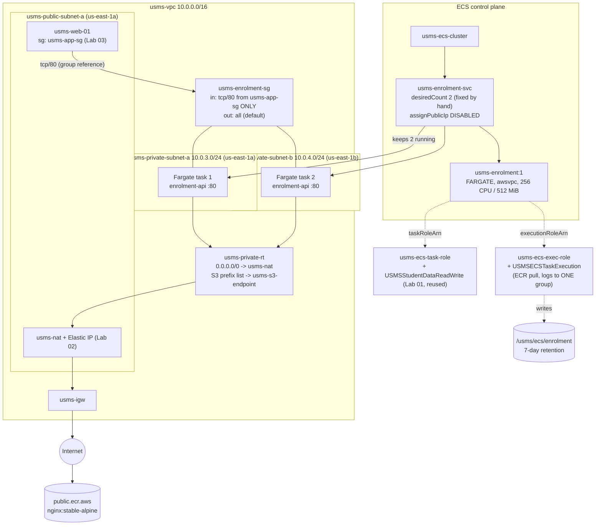

*Image Source: Mermaid diagram authored for this report from the lab's Section 5 architecture.*

---

## 5. Implementation Procedure

All commands were run with AWS CLI v2.36 against Floci (`http://localhost:4566`) from `aws-floci-course/`, continuing from Labs 01 to 03.

**Two corrections to the lab's literal commands** were needed, the same trap my Lab 02 report recorded. `configs/lab-01.env` stores `USMS_ROLE_DEVELOPER` and `USMS_POLICY_S3_RW` as **full ARNs**, so Step 4's `arn:aws:iam::${ACCOUNT_ID}:role/${USMS_ROLE_DEVELOPER}` and Step 7's `arn:aws:iam::${ACCOUNT_ID}:policy/${USMS_POLICY_S3_RW}` would each have produced a malformed, doubled ARN. Both variables were used directly.

 

#### Step 1: Resume the environment and load four env files

Floci was already running under Compose. I sourced `course.env` and `lab-01.env` through `lab-03.env`, and `whoami.sh` reported account `000000000000`. All eight values this lab consumes were non-empty, including `private subnet b` (`subnet-0d751e14`, created while closing the Lab 02 gap during Lab 03).

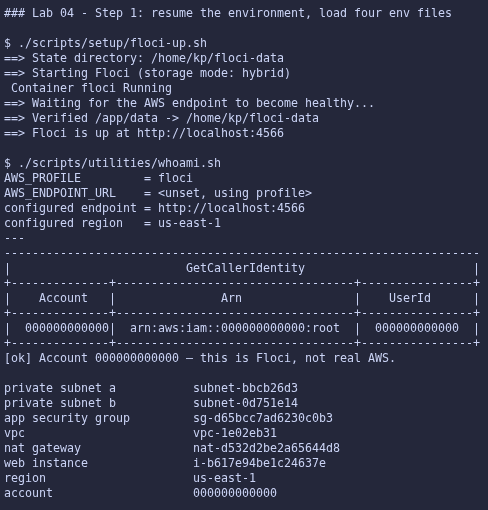

 

#### Step 2: Confirm Labs 2 and 3 are still intact

`verify-lab-02.sh` reported `PASS=36 FAIL=0` and `verify-lab-03.sh` reported `PASS=36 FAIL=0`. That includes the two checks this lab depends on: the private route table has no IGW route, and `usms-web-01` carries `usms-app-sg`.

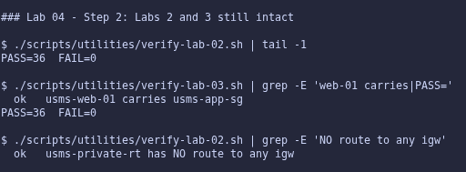

 

#### Step 3: Probe what this Floci build supports (Checkpoint 1)

The raw probe printed two `not available` lines, which needed reading rather than trusting:

- `ecs describe-services` was a false negative. It answered with `ClusterNotFoundException`, which the lab defines as supported.
- `describe-scheduled-actions` returned a genuine `UnsupportedOperation`.

**Support path recorded: A (full)**, with the scheduled-actions gap noted for Lab 06 in `notes/lab-04-notes.md`.

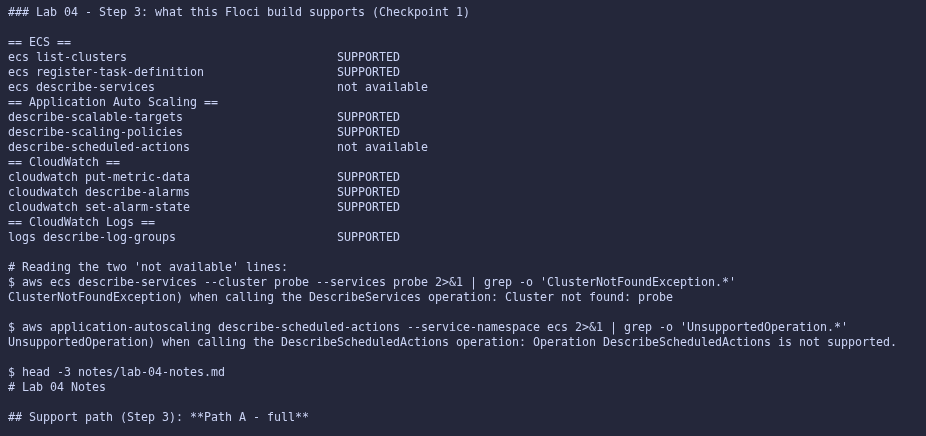

 

#### Step 4: Create the ECS cluster, as the developer role

Assumed `usms-developer-role` via the `usms-dev` profile (credentials saved to `outputs/lab-04-assumed-role.json`, `chmod 600`). `get-caller-identity` returned an `assumed-role/usms-developer-role/…` ARN. Floci reported the session as `floci-session` rather than `lab04-ecs-build`, which is a limitation.

As that role I created `usms-ecs-cluster` (ECS lower-case `key=/value=` tags), then unset the three variables and confirmed I was back to my normal identity. `describe-clusters` shows `ACTIVE` with 0 services and 0 tasks. However, `Settings` is `null`: Floci did not store `containerInsights=enabled`, so Lab 06 will need a custom metric on this build.

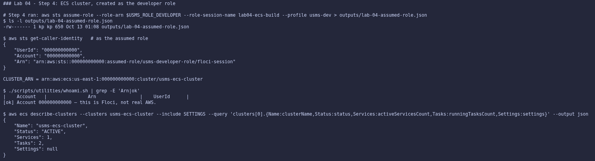

 

#### Step 5: Create the log group

Created `/usms/ecs/enrolment` (CloudWatch Logs plain-map tags) with a separate `put-retention-policy` of 7 days. `describe-log-groups` shows one row, `Retention 7`, `Bytes 0`.

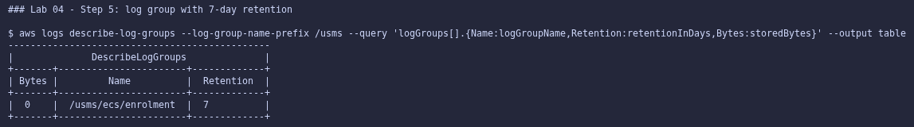

 

#### Step 6: Create the task execution role

`policies/trust-ecs-tasks.json` (quoted heredoc, valid JSON) trusts `ecs-tasks.amazonaws.com`. I created `usms-ecs-exec-role`, and wrote and created the least-privilege `USMSECSTaskExecution`:

- ECR pull actions on `*`, because `GetAuthorizationToken` takes no resource;
- `logs:CreateLogStream`/`PutLogEvents` scoped to the **one** log group `/usms/ecs/enrolment:*`.

That policy is attached to the role. The verify step shows the principal is `{"Service": "ecs-tasks.amazonaws.com"}`, and the attached policy is `USMSECSTaskExecution`.

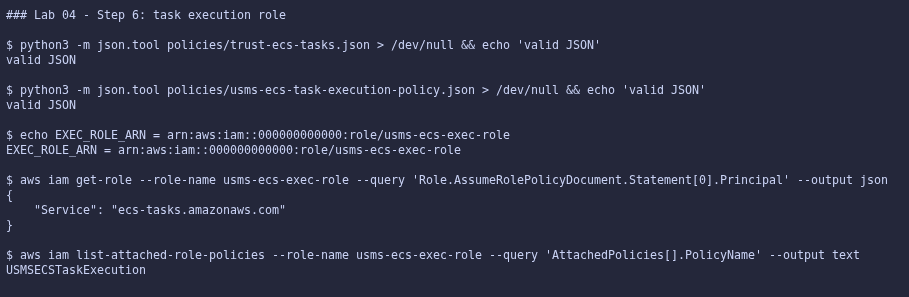

 

#### Step 7: Create the task role and reuse Lab 01's policy (Checkpoint 2)

Created `usms-ecs-task-role` from the same trust file and attached Lab 01's `USMSStudentDataReadWrite` by its ARN. No copy was made. The policy document read back (`outputs/lab-04-task-role-policy.json`) is **byte-identical** to Lab 03 Step 11's `outputs/lab-03-instance-policy.json` (`diff` empty). One policy now reaches two kinds of compute through two mechanisms: an instance profile and a task role.

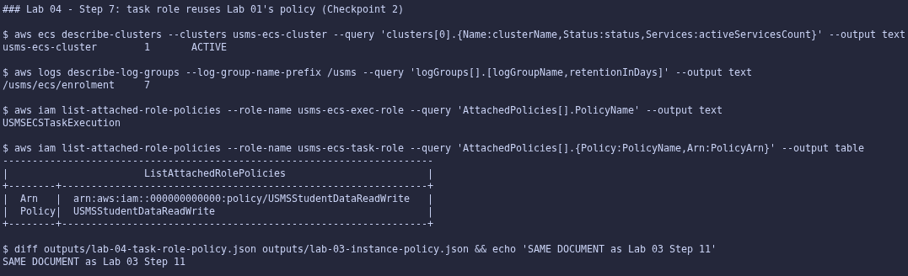

 

#### Step 8: Create the enrolment security group

Created `usms-enrolment-sg` (`sg-aa114e46fb208dcb3`). Its single ingress rule was written to `policies/usms-enrolment-sg-ingress.json` (unquoted heredoc, so `$USMS_APP_SG` expanded) and authorised: tcp/80 with `FromGroup sg-d65bcc7ad6230c0b3` (`usms-app-sg`) and `FromCIDR null`. `OutboundRules` is `1`, the default allow-all egress the image pull relies on.

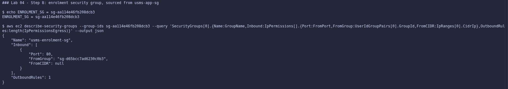

 

#### Step 9: Write and register the task definition (Checkpoint 3)

`templates/lab-04-taskdef.json` is valid JSON with `grep -c '\$'` = `0`. Registering it produced `usms-enrolment:1`, which reads back as:

- `ACTIVE`, `awsvpc`, `FARGATE`;
- `"256"`/`"512"`;
- container `enrolment-api` on `public.ecr.aws/nginx/nginx:stable-alpine`;
- two **different** role ARNs (`usms-ecs-exec-role` and `usms-ecs-task-role`).

**Floci limitation:** `LogGroup` read back as `null`. Inspecting the stored container definition showed Floci had silently dropped the whole `logConfiguration` block (and stored `hostPort: 0`), although the registered file contains both. On real AWS the `awslogs` configuration is stored and the tasks would stream to `/usms/ecs/enrolment`.

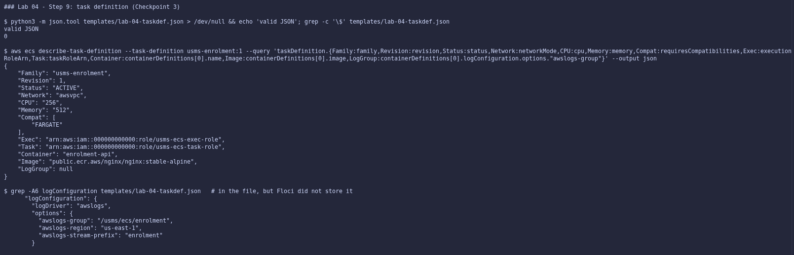

 

#### Step 10: Create the service in the private subnets

Created `usms-enrolment-svc` with desired count 2, `FARGATE`, both private subnets, `usms-enrolment-sg`, `assignPublicIp=DISABLED`, and managed and propagated tags. The ARN has the shape `service/usms-ecs-cluster/usms-enrolment-svc`, the suffix Lab 06's scalable target needs.

`services-stable` returned `service stable`, and the polling loop showed `2 2 0` on the first attempt. Floci pulled `nginx:stable-alpine` and **two real containers** started within about 10 seconds; real Fargate takes 20 to 60 seconds. On real AWS that pull would travel `usms-private-rt` → `usms-nat` → `usms-igw` → `public.ecr.aws`, with layer data through `usms-s3-endpoint`.

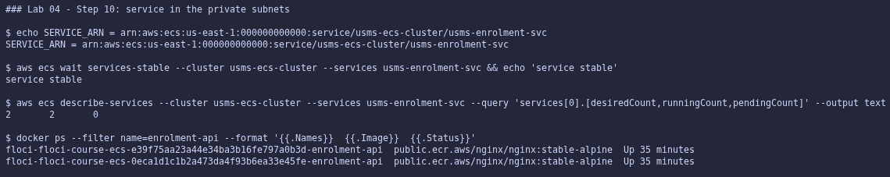

 

#### Step 11: Read the service back (Checkpoint 4)

The read-back shows:

- `ACTIVE`, `FARGATE`;
- `Desired 2`, `Running 2`, `Pending 0`;
- subnets `subnet-bbcb26d3` and `subnet-0d751e14` (both private subnets);
- security group `sg-aa114e46fb208dcb3`;
- `PublicIP DISABLED`.

Two Floci differences:

- `TaskDef` is stored as the bare family `usms-enrolment` rather than the `:1` ARN.
- The service has **no `events` list** (`None`).

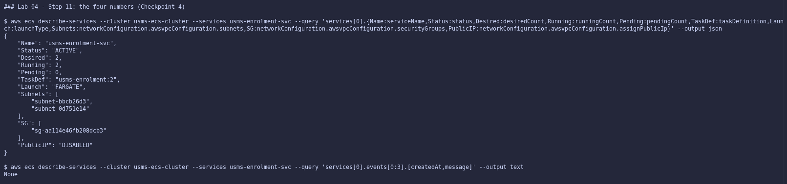

**Your turn (capacity by hand):** I ran `update-service --desired-count 3`, waited for it to stabilise, then ran `--desired-count 2`. Because Floci provides no `events`, the evidence is the four counts plus the real containers:

- before: desired 2 / running 2, with 2 containers;
- after the change to 3: desired 3 / running 3, with 3 containers;
- after the change back: desired 2 / running 2, with 2 containers.

This is exactly what a Lab 06 scaling policy will do automatically. Only `desiredCount` was changed by me; the service did the rest.

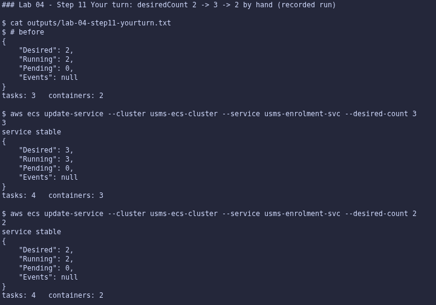

 

#### Step 12: Write `configs/lab-04.env`

Every value is recorded by lookup, with an unquoted heredoc. Before trusting the lab's `tag:Name` lookup for the security group, I tested it, because Floci ignored tag filters on Elastic IPs in Lab 03. On security groups the filter works: a non-existent name returns nothing. The completeness check prints `all values populated`, and the eight printed values are non-empty, including `baseline desired 2`. The file has **17** exports.

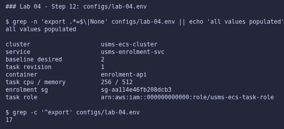

 

#### Step 13: Commit (Checkpoint 5)

Ran `git status --short` and `git check-ignore -v outputs/lab-04-assumed-role.json` first, then staged by explicit path: `labs/lab-04-ecs/`, `configs/lab-04.env`, the three policy files, both task-definition templates, `notes/lab-04-notes.md`, and the verify, inventory and cleanup scripts. Nothing under `outputs/` was staged.

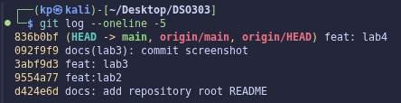

 

#### Section 8.1: `verify-lab-04.sh`

Built verbatim from the lab. The first run gave `PASS=37 FAIL=1`, and the only failure was `no secret is tracked by git`. Running `git ls-files | grep ^outputs/` showed the sole match was `outputs/.gitkeep`, the placeholder Step 13 itself requires to be tracked. The check `! git ls-files | grep -q '^outputs/'` therefore fails on every correct repository.

I changed only that line, to exclude `.gitkeep` (with a comment). A negative test proved it still catches a real leak: a temporarily tracked `outputs/zz-fake-secret.json` turned it into `FAIL`, and the file was then removed. Final result: **`PASS=38 FAIL=0`**.

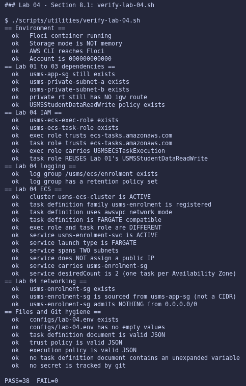

 

#### Section 8.2: `lab-04-cleanup.sh`

Built verbatim from the lab, guarded by `DELETE USMS ECS`. `bash -n` reported `syntax OK - do NOT run it`. It was **not** run.

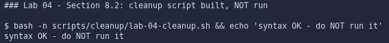

 

#### Independent exercises

All five are documented in full in `labs/lab-04-ecs/exercises.md`:

1. `usms-results-svc` deployed: two `ACTIVE` services.
2. `usms-enrolment:2` (1024 MiB, `USMS_LOG_LEVEL`) registered, the service repointed, and `:1` still `ACTIVE`. Floci never rolled the tasks, even with `--force-new-deployment`.
3. `lab-04-ecs-inventory.sh`, giving identical output from two directories, with the `SAME`/`RISK` verdicts proven on a temporary service that was then removed.
4. A capacity plan derived from first principles (min 2, scheduled floor 10, max 12, CPU target 60%) with Fargate costs of USD 18.02 vs 90.10 vs about 18.59 per month, and `usms-results-svc` deleted with verify still `FAIL=0`.
5. `LOOP CLOSED` to `usms-web-01` (with `usms-web-02` explained) and the ECS tag audit.

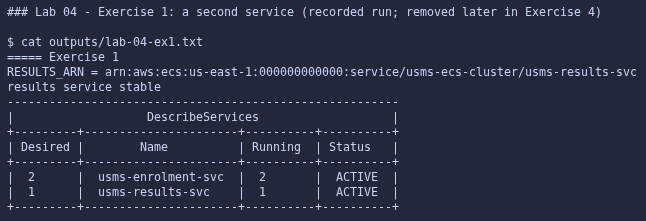
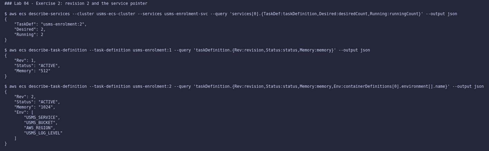
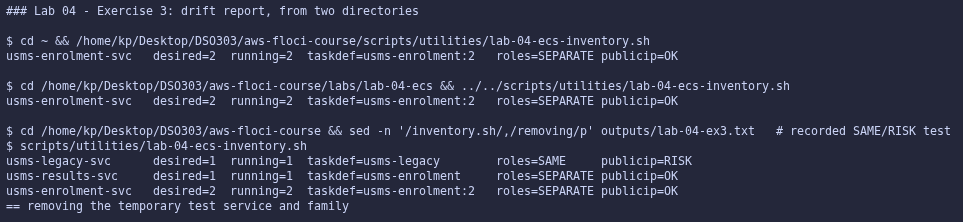
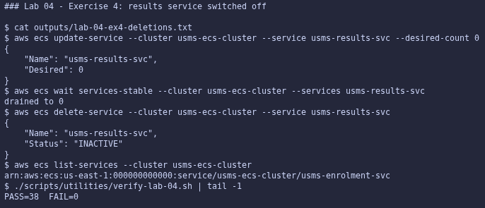
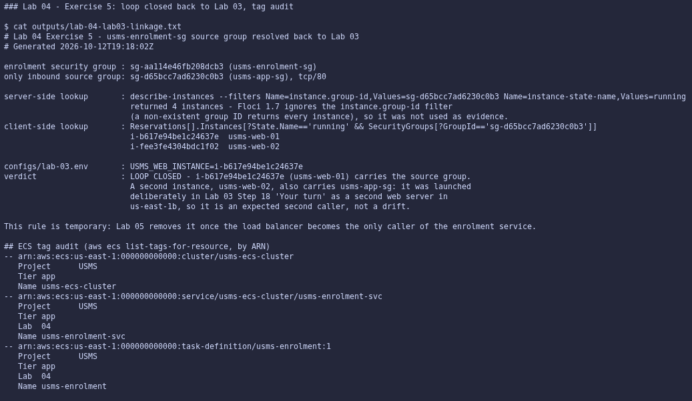

---

## 6. Results and Evidence

### 6.1 CLI Output

**Screenshot 1: both ECS roles, Lab 01's policy reused (Checkpoint 2, Step 7)**

*Image Source: `aws-floci-course/screenshots/lab4/s7.png`*

 

**Screenshot 2: task definition with two different role ARNs (Checkpoint 3, Step 9)**

*Image Source: `aws-floci-course/screenshots/lab4/s9.png`*

 

**Screenshot 3: service desired 2, both private subnets, no public IP (Checkpoint 4, Step 11)**

*Image Source: `aws-floci-course/screenshots/lab4/s11.png`*

 

**Screenshot 4: `verify-lab-04.sh` PASS=38 FAIL=0 (Section 8.1)**

*Image Source: `aws-floci-course/screenshots/lab4/s14.png`*

 

All screenshots referenced in Section 5 are stored in `aws-floci-course/screenshots/lab4/`.

### 6.2 AWS Console Verification

Not applicable. Floci is a CLI-only local emulator with no web console. All verification was done through the AWS CLI, plus `docker ps`/`docker inspect` on the task containers where Floci's API fell short.

---

## 7. Analysis and Discussion

All 13 steps, both Section 8 scripts, the Step 11 "Your turn" and all five exercises were completed:

- `verify-lab-04.sh` reports `PASS=38 FAIL=0`, alongside `verify-lab-02.sh` and `verify-lab-03.sh` (both `PASS=36 FAIL=0`).
- All five checkpoints were met, and `configs/lab-04.env` has 17 populated exports.
- Observed: the cluster, both roles and their trust, the reused policy, the group-referenced rule, the task definition revisions, the service placement across two private subnets, and `desiredCount` changed by hand with real containers following it.
- Only reasoned about: Container Insights metrics, task credentials, security-group enforcement, log delivery, rolling deployments, real Fargate start latency and cost.

Issues encountered and how each was resolved:

- **Doubled ARNs in Steps 4 and 7.** `lab-01.env` stores full ARNs, so the lab's ARN reconstruction would have been malformed. Resolved by using the variables directly, as in Lab 02.
- **False negatives in the Step 3 probe.** The probe uses exit codes, so a `ClusterNotFoundException` looked like "not available". Resolved by reading the actual error before recording the support path.
- **Floci silently dropped `logConfiguration`.** It was caught only because the read-back returned `null` where a value was expected. I investigated the stored container definition instead of assuming my JSON was wrong, and the source file was confirmed correct.
- **No service `events`.** The "Your turn" evidence was rebuilt from the counts and `docker ps`, which arguably prove more, since they show real containers starting and stopping.
- **A deployment that never deployed.** `update-service --task-definition :2` (even with `--force-new-deployment`) changed only the pointer. `describe-tasks` and `docker inspect` exposed that the running tasks were still `:1`. On real AWS this would be a rolling replacement.
- **A buggy check in the provided verify script.** It flagged the required `outputs/.gitkeep` as a leaked secret. I fixed only that line and proved the fix with a negative test.
- **A filter that matched everything.** Floci ignores `instance.group-id`, so Exercise 5's lab command "resolved" the web tier's security group to all four running instances. I used a client-side JMESPath lookup instead. The resulting second instance (`usms-web-02`) was explained rather than ignored.

The theme continues from Lab 03: **an API that accepts a request has not proven it did what was asked**. Every value was read back, and when a read-back disagreed I looked one layer down (the stored definition, the containers' environment) before drawing a conclusion.

---

## 8. Reflection

**1. What did you learn about this AWS service?**

ECS is a small set of objects with very clear responsibilities. The task definition says *what*, the service says *how many* and *where*, and the reconciliation loop is the only thing that ever starts or stops a task. That makes the scaling model obvious: anything that "scales" ECS (a person, a scheduled action, a target tracking policy) does nothing except change `desiredCount`. I also understood why there are two roles. The platform needs permission to pull and log before my code exists, and my code needs its own, separate permissions once it runs.

**2. What challenges did you encounter?**

The hardest part was not believing a success message. `register-task-definition` succeeded but dropped the log configuration. `update-service` succeeded and reported a `PRIMARY` deployment on revision 2 while nothing was redeployed. A filter "worked" and returned every instance. Each of these was caught only by checking a second source. The other challenge was the recurring full-ARN-versus-name mismatch from `lab-01.env`, which is easy to miss because the broken command still looks plausible.

**3. How would you apply this service in a real-world cloud environment?**

As built here, but with a private ECR repository for the real image and a CI pipeline that registers a new task definition revision per release and updates the service. The setup would also include:

- a deployment circuit breaker with automatic rollback;
- the Lab 05 load balancer with health checks, so a bad revision is caught before it receives traffic;
- the Lab 06 scaling plan from Exercise 4, so the service pre-warms before predictable peaks and scales in when idle;
- separate execution and task roles per service, each with least privilege, and group-referenced security rules throughout.

**4. What additional concepts or features would you like to explore?**

ECS deployment circuit breakers and blue/green deployments with CodeDeploy, ECS Exec for debugging a running task without SSH, Fargate Spot capacity providers for the non-critical part of the capacity, and Container Insights metrics observed on a real account.

---

## 9. Conclusion

This lab's objectives were achieved. The USMS enrolment service now runs on Amazon ECS:

- `usms-enrolment-svc` keeps two Fargate tasks running, one in each private subnet, with no public IP;
- it is reachable only from the web tier's security group;
- it is defined by the immutable `usms-enrolment` task definition, with a least-privilege execution role and a task role that reuses Lab 01's `USMSStudentDataReadWrite` unchanged;
- everything is recorded in `configs/lab-04.env` (17 exports), and the work verifies at `PASS=38 FAIL=0`.

Key concepts learned:

- ECS's four objects and the reconciliation loop;
- `desiredCount` as the single lever any form of scaling pulls;
- Fargate's `awsvpc` networking, which removes servers but not subnets, routes or security groups;
- the execution-role versus task-role split, with their distinct failure symptoms;
- why a group reference beats a CIDR once task addresses churn.

Skills developed include driving ECS from version-controlled request files, deriving a capacity plan and its cost from stated assumptions, and verifying a control plane's claims against the containers it actually runs. Lab 05 can now put a load balancer in front of `usms-enrolment-svc`, and Lab 06 can put its `desiredCount` under Application Auto Scaling.

---

## 10. Appendix

| Item | Path |
|---|---|
| Trust policy (both ECS roles) | `aws-floci-course/policies/trust-ecs-tasks.json` |
| Execution role policy | `aws-floci-course/policies/usms-ecs-task-execution-policy.json` |
| Enrolment SG ingress rule | `aws-floci-course/policies/usms-enrolment-sg-ingress.json` |
| Task definitions (rev 1, rev 2) | `aws-floci-course/templates/lab-04-taskdef.json`, `lab-04-taskdef-rev2.json` |
| Generated names and ARNs | `aws-floci-course/configs/lab-04.env` |
| Exercises write-up | `aws-floci-course/labs/lab-04-ecs/exercises.md` |
| Lab 03 linkage (Exercise 5) | `aws-floci-course/labs/lab-04-ecs/lab03-linkage.txt` |
| Review questions, support path, Floci limitations | `aws-floci-course/notes/lab-04-notes.md` |
| Verification script | `aws-floci-course/scripts/utilities/verify-lab-04.sh` |
| Inventory script (Exercise 3) | `aws-floci-course/scripts/utilities/lab-04-ecs-inventory.sh` |
| Cleanup script (not run) | `aws-floci-course/scripts/cleanup/lab-04-cleanup.sh` |
| Evidence files (git-ignored) | `aws-floci-course/outputs/lab-04-*` |
| All screenshots | `aws-floci-course/screenshots/lab4/` |

---

## Submission Checklist

- [x] Student information completed
- [x] Objectives stated
- [x] Introduction provided
- [x] Real-world use case described
- [x] Tools listed
- [x] System design included
- [x] Implementation documented
- [x] CLI outputs included
- [ ] Console screenshots attached *(not applicable: Floci is CLI-only, no web console)*
- [x] Analysis completed
- [x] Reflection completed
- [x] Conclusion written
- [x] Appendix attached
