# AWS Practical Laboratory Report

**Student Name:** Kinley Palden

**Student ID:** 02230287

**Course:** DSO303

**Lab Number / Title:** Lab 05: Putting the ECS Service Behind an Application Load Balancer

**Date:** 2026-10-13

---

## 1. Aim / Objective

To give Lab 04's `usms-enrolment-svc` a stable name: an internet-facing Application Load Balancer in Lab 02's two public subnets, with its own security group. The lab then:

- creates an `ip` target group with a deliberate health check and deregistration delay, an HTTP:80 listener and one listener rule;
- attaches the existing service so that ECS registers and deregisters its own tasks;
- cuts over so the load balancer is the only thing that can reach the tasks;
- observes a deployment, proves the stack survives a restart, and records its ARNs in `configs/lab-05.env` for Lab 06.

---

## 2. Introduction

Elastic Load Balancing distributes client requests across a changing set of targets behind one stable DNS name. An **Application Load Balancer** works at layer 7 (HTTP) and has security groups. It is built from four objects:

- the **load balancer** (DNS name, subnets, security group);
- **listeners** (a port and protocol, with exactly one default action);
- **rules** (a condition and an action, evaluated lowest priority number first);
- **target groups** (the targets, plus the **health check** that decides which receive traffic).

For ECS on Fargate, the target group must be `--target-type ip`, because `awsvpc` tasks have network interfaces but no instance IDs. The **ECS service** keeps the target group's membership current, registering each task it starts and deregistering each one it stops. A deregistered target drains in-flight requests for the deregistration delay before ECS stops it, which is what makes deployments and scale-in zero-downtime.

This lab ran on **Floci 1.7.0**, which turned out to run a **real ELBv2 data plane** inside the course's Docker network. Real health checks, real rule evaluation and real HTTP responses through the load balancer were therefore observable, alongside several control-plane gaps recorded below.

---

## 3. Use Case

Load balancers sit in front of almost every production web service:

- a stable entry point for a fleet of web or API servers whose addresses change constantly;
- health-based routing that stops sending traffic to a failed instance within seconds;
- zero-downtime deployments, by registering new versions and draining old ones;
- path- and host-based routing, sending `/api/*` and `/static/*` to different services behind one hostname;
- the anchor for HTTPS termination, web application firewalls and request-based auto scaling.

In this lab, the USMS enrolment API, previously reachable only by task address from the web tier, now sits behind `usms-enrolment-alb`. The web tier calls a name, the ALB forwards to whichever tasks the service currently runs, and the tasks accept connections from the load balancer and nothing else.

---

## 4. System Architecture / Design

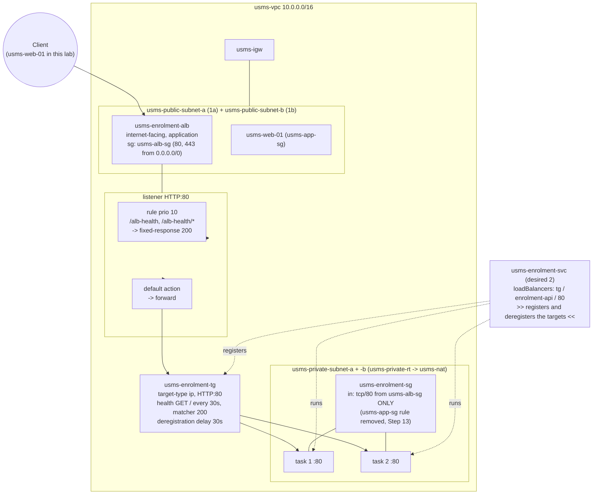

*Image Source: Mermaid diagram authored for this report from the lab's Section 5 architecture.*

---

## 5. Implementation Procedure

All commands were run with AWS CLI v2.36 against Floci (`http://localhost:4566`) from `aws-floci-course/`, continuing from Labs 01 to 04. Before starting, the current output of every Lab 04 screenshot step was saved to `outputs/lab4-evidence/`, because this lab deliberately changes Lab 04's security group and service.

 

#### Step 1: Resume the environment and load five env files

Floci was up under Compose and the storage check was all `[ok]` (hybrid, real bind mount). All twelve values were non-empty, including both public subnets (`subnet-51dea2ed` in `us-east-1a`, `subnet-56019841` in `us-east-1b`) and the enrolment security group.

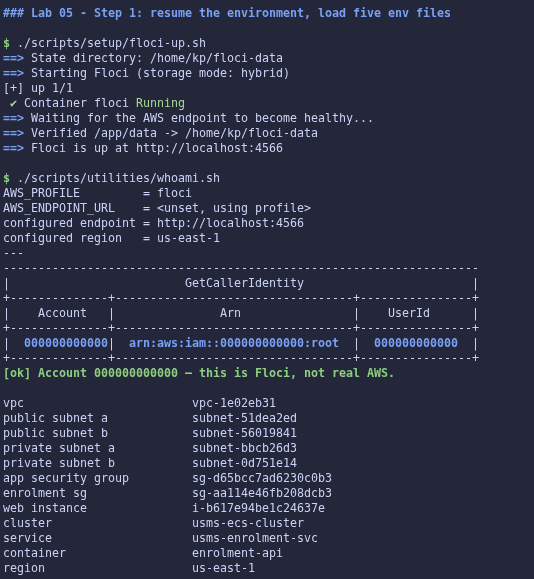

 

#### Step 2: Confirm Labs 02, 03 and 04 are intact

`verify-lab-02.sh` reported `PASS=36 FAIL=0`, `verify-lab-03.sh` `PASS=36 FAIL=0`, and `verify-lab-04.sh` `PASS=38 FAIL=0`. The last was saved as `outputs/lab-05-pre-verify-04.txt` for comparison after Step 13.

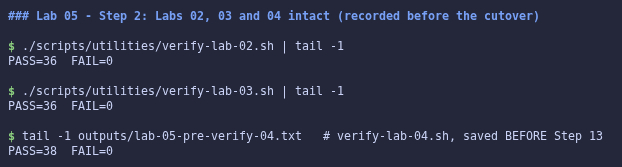

 

#### Step 3: Probe ELBv2 support (Checkpoint 1)

All ten probes answered. Later steps confirmed **support path A (full)**: Floci logged `ELBv2 listener port started on 80` and served real requests (Step 12). The path is recorded at the top of `notes/lab-05-notes.md`.

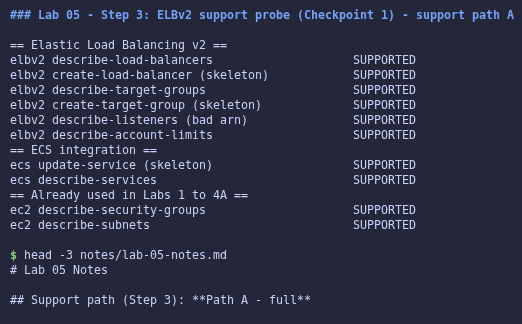

 

#### Step 4: The load balancer's security group

Created `usms-alb-sg` (`Tier=edge`) and authorised tcp/80 from `0.0.0.0/0` from a quoted-heredoc JSON document: exactly one inbound rule, and one default egress rule.

**Your turn:** added tcp/443 from `0.0.0.0/0` from `policies/usms-alb-sg-ingress-https.json`, giving two inbound rules (80 and 443). The answer is in the notes: 443 is now *open*, but nothing *listens*. That needs an HTTPS listener and a certificate. The certificate is free from ACM, but the domain name it validates must be obtained outside AWS.

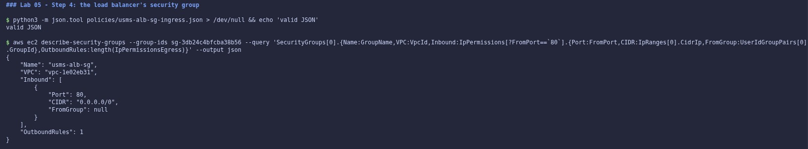
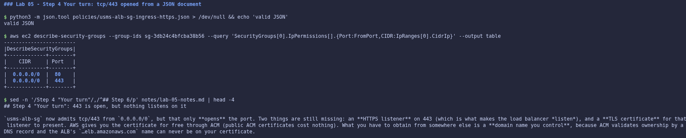

 

#### Step 5: Create the Application Load Balancer (Checkpoint 2)

Created `usms-enrolment-alb`: `internet-facing`, `application`, IPv4, both public subnets, and `usms-alb-sg`. The waiter returned immediately; real AWS takes 2 to 4 minutes. The read-back shows `active`, two AZs (`us-east-1a`, `us-east-1b`) and the DNS name `usms-enrolment-alb-59dc0d3ea7324f5e.elb.floci`. `idle_timeout.timeout_seconds=60` and `drop_invalid_header_fields=true` were set and read back.

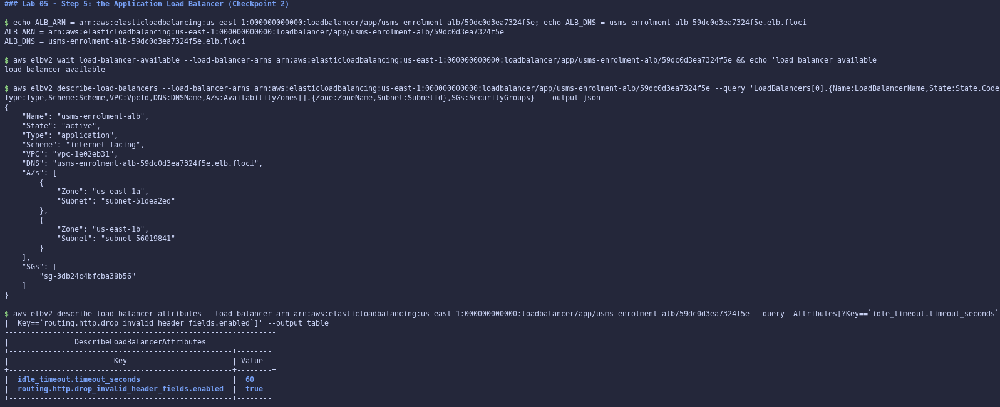

 

#### Step 6: Create the target group

Created `usms-enrolment-tg`: `ip`, HTTP:80, in `usms-vpc`, health check `GET /` on the traffic port every 30 s, with a 5 s timeout, thresholds 2/2, matcher `200`, `LBs 0`, and an empty target list.

**Your turn:** `modify-target-group --matcher HttpCode=200-399` read back as `200-399`, then the matcher was restored to `200`, with no recreation needed.

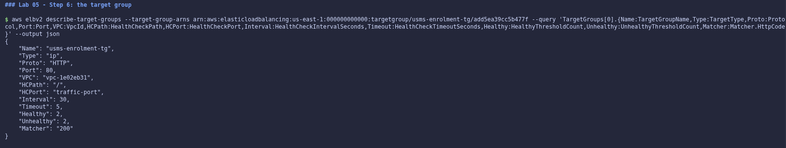
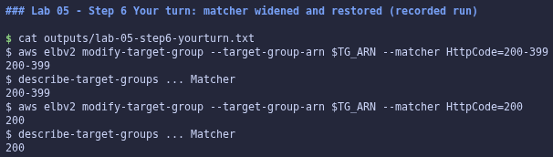

 

#### Step 7: Target group attributes

`deregistration_delay.timeout_seconds=30` and `load_balancing.algorithm.type=least_outstanding_requests` were set and read back. Floci lists only the attributes that were set, not the full default list.

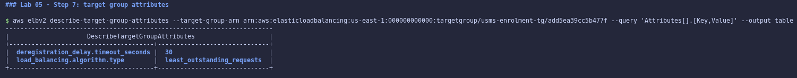

 

#### Step 8: Create the listener (Checkpoint 3)

The default action document (unquoted heredoc, `grep -c '\$'` = `0`) forwards to the target group. The listener is `HTTP:80`, with a `forward` default action to `usms-enrolment-tg`, and the target group now reports `AttachedToLoadBalancers: 1`.

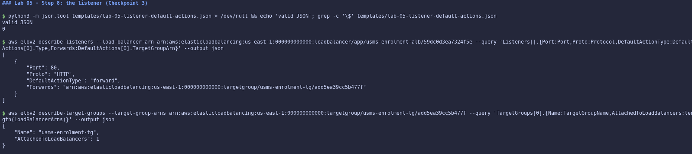

 

#### Step 9: Let the load balancer reach the tasks

Authorised tcp/80 from `usms-alb-sg` on `usms-enrolment-sg` (unquoted heredoc, zero `$`). Both sources now coexist, as the lab intends: build the new path before removing the old one. Floci stored them as two separate `IpPermission` entries, where real AWS merges them into one.

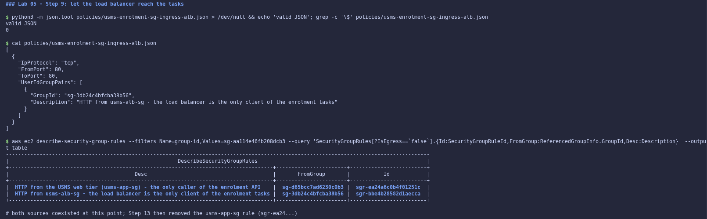

 

#### Step 10: Attach the service to the target group

`templates/lab-05-service-load-balancers.json` names the target group, `enrolment-api` and port 80. `update-service --load-balancers … --health-check-grace-period-seconds 60` returned success, but **Floci stored nothing** (`LB: null`).

I took the lab's documented **fallback**: scale to 0, delete the service, and recreate it with the **same** name, cluster, task definition (`usms-enrolment:2`) and desired count, with the load balancer attached. The fallback's `--deployment-configuration file://templates/lab-04-deployment-config.json` was omitted because my Lab 04 never created that file, so ECS defaults apply. The recreated service has the **same ARN** as `configs/lab-04.env`, one `loadBalancers` entry, and 2/2 running. The grace period is still not stored (a Floci limitation).

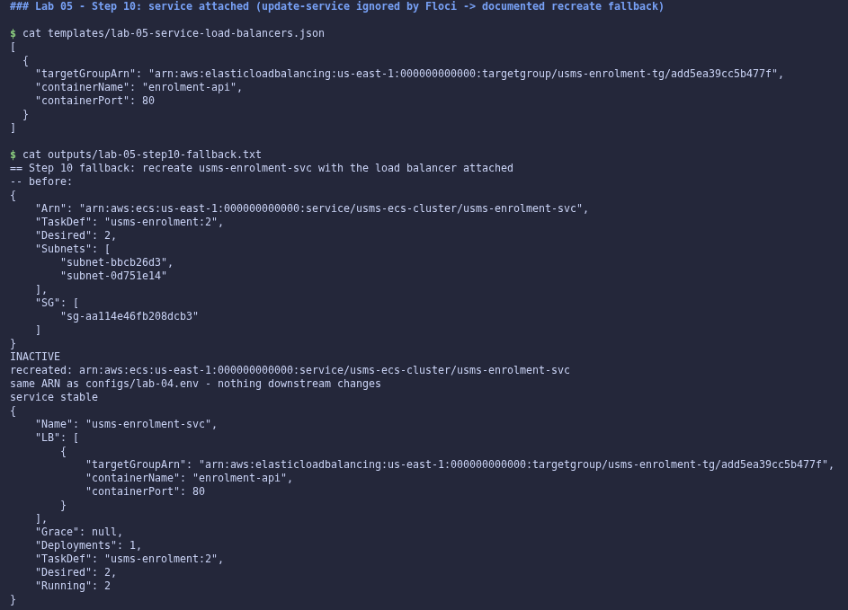

 

#### Step 11: Targets register themselves (Checkpoint 4)

With no `register-targets` command run by me, two targets appeared. One showed `initial` (`Elb.InitialHealthChecking`), and on the next poll both were `healthy`: **real health checks**. ECS reports `Desired 2 / Running 2 / Pending 0`, one deployment, `COMPLETED`. Side by side, ECS `healthStatus` is `None` (no container health check) and the targets are `healthy`, the table's "not a fault" row. The target addresses are Floci's Docker IPs (`172.19.0.x`), not `10.0.3/4.x`.

**Your turn:** at `desired-count 3` the target group showed three `healthy` targets, and back at 2 it showed two again. `register-targets`/`deregister-targets` were never run.

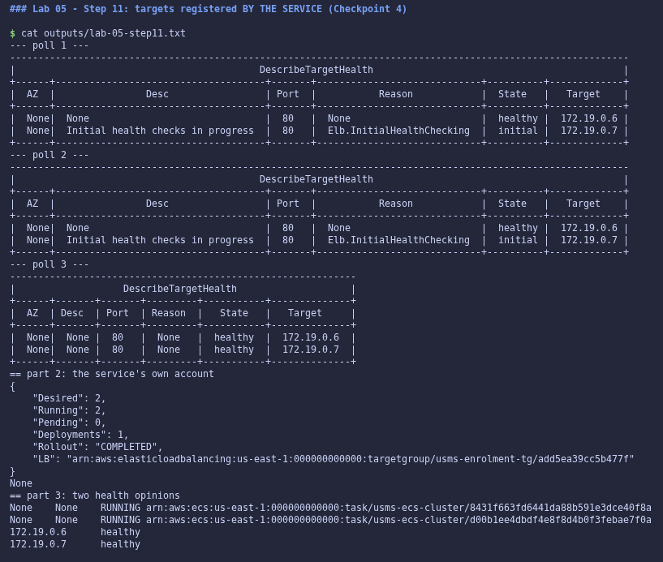
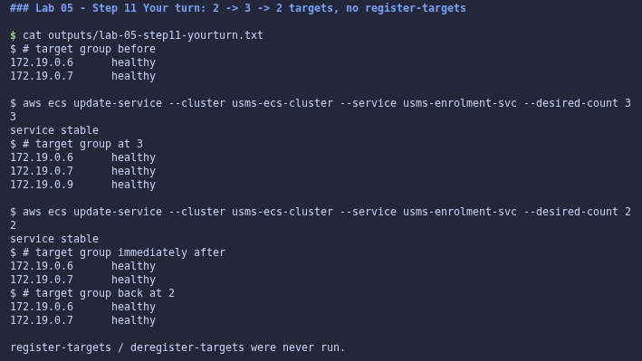

 

#### Step 12: Prove the path

From the laptop, the `…elb.floci` name does not resolve (no public DNS), exactly as the lab predicts. **From `usms-web-01`'s own container**, the real client in this architecture, the name resolves to Floci's listener, and three requests returned **`http_code=200`** with nginx's page (`Server: nginx/1.30.5`). That is a request through the listener, to a task, and back. The control-plane proof (`outputs/lab-05-path-proof.txt`) also holds link by link. Its block 3 flags the Docker IPs as "not in a Lab 02 private subnet", which I investigated: they are exactly the two task containers' addresses.

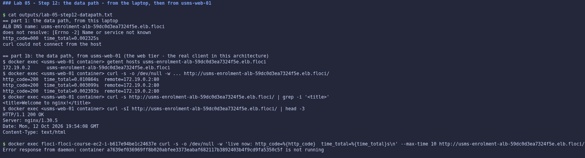

 

#### Step 13: The cutover

`describe-security-group-rules` identified `sgr-ea24a6c0b4f01251c`, the exact rule Lab 04 created. `revoke … --security-group-rule-ids` returned `True` but removed **nothing**, which is another silent no-op. Revoking with `--ip-permissions file://policies/usms-enrolment-sg-ingress.json` (Lab 04's own document) worked: `usms-enrolment-sg` now has exactly one source, `usms-alb-sg`. Floci's separate rules index still lists the old rule, and that inconsistency is recorded.

`verify-lab-04.sh` then changed exactly **one** check (`38/0` → `37/1`), and the load-balanced path still returned `200`.

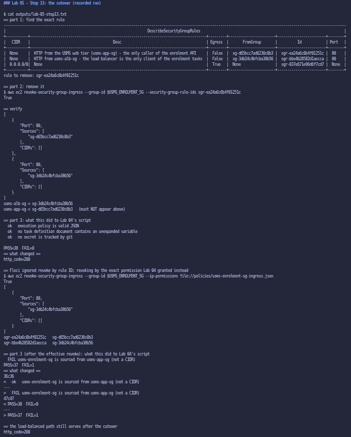

 

#### Step 14: A deployment behind the load balancer (Checkpoint 5)

The pre-deploy snapshot was recorded and `--force-new-deployment` was issued. **Floci replaced nothing**: the pre and post files show identical task IDs and addresses, so the `initial`/`healthy`/`draining` sequence could not be observed through a deployment. In Step 11, `initial` → `healthy` *was* observed, and on scale-in the removed target vanished without a `draining` state.

I also found that the lab's polling loop queries `length(deployments)` without `services[0]`, which errors on every poll and never breaks out of the loop.

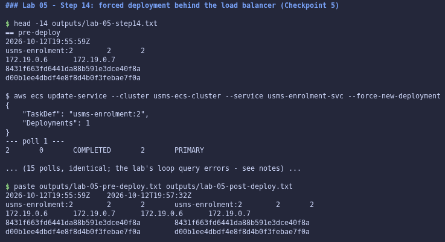

 

#### Step 15: A listener rule (Checkpoint 6)

Created the priority-10 rule (`/alb-health`, `/alb-health/*` → `fixed-response 200 text/plain`). `describe-rules` lists it above the `default` forward, with the patterns stored under `PathPatternConfig.Values`. Over the real data path, from `usms-web-01`:

- `/` → `200`, 896 bytes (nginx);
- `/alb-health` → `200`, 22 bytes (`usms-enrolment-alb ok`, no task involved);
- `/alb-health/x` → `200`;
- `/alb-healthcheck-internal` → `404` (forwarded, not matched).

**The rule fires.**

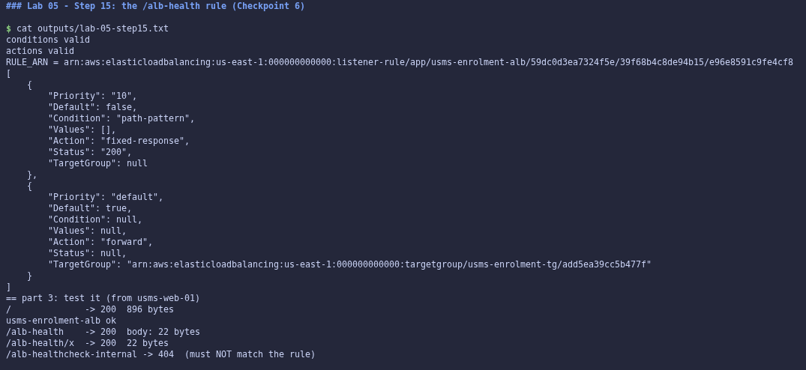

 

#### Step 16: Restart persistence (Checkpoint 7)

I recorded the seven facts, restarted Floci, re-derived every ARN from the API (by name, and by walking down from the load balancer), and diffed: **`PERSISTENCE PROVEN`**. The data path still returned `200` for `/` and `/alb-health`.

Runtime side effects, recorded and handled:

- Floci lost track of the two original tasks. Their containers kept running and stayed registered, alongside two replacement tasks, giving **four** targets for desired 2. I deregistered only the two orphaned addresses and removed their containers, leaving the two service-owned targets.
- `usms-db-02` came back `stopped` and was left so, to avoid Lab 03's port-collision bug.

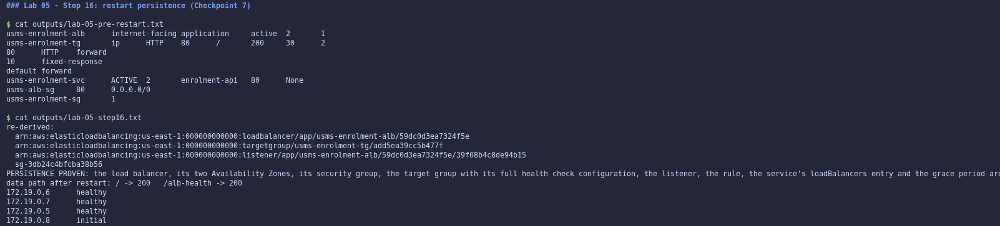

 

#### Step 17: Close the loop and audit

- Who can reach the ALB: 80 and 443 from `0.0.0.0/0`.
- Who can reach the tasks: **`CUTOVER CONFIRMED`**, with `usms-alb-sg` as the only source.
- The client: **`LOOP CLOSED`** for `usms-web-01`, with `usms-web-02` (Lab 03's second web server) explained. Floci ignores `instance.group-id`, so the carriers were selected client-side.
- `describe-tags` shows all four ELB objects tagged `Lab=05`.

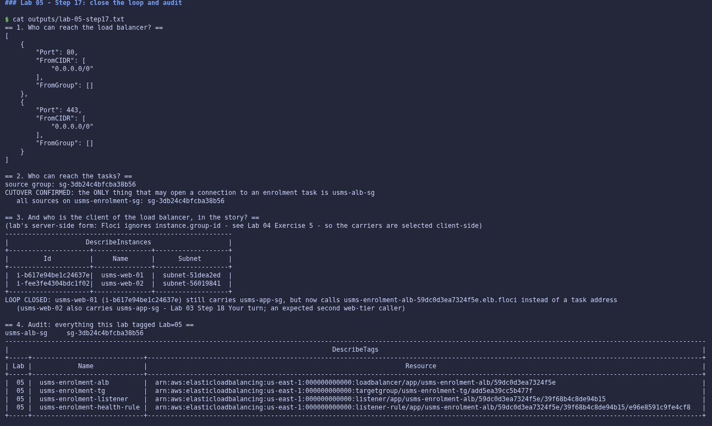

 

#### Step 18: `configs/lab-05.env`

Every value was recorded by lookup: 15 exports, plus `USMS_ALB_RESOURCE_LABEL` from Exercise 5, making 16. Two issues:

- The lab's `` \` `` escaping leaves a backslash inside the query in both bash and zsh (tested), so the listener ARN was empty. It was looked up with `Listeners[?to_string(Port)=='80']` instead.
- `USMS_SVC_GRACE_PERIOD=None` is left honest and commented, because Floci never stores the value.

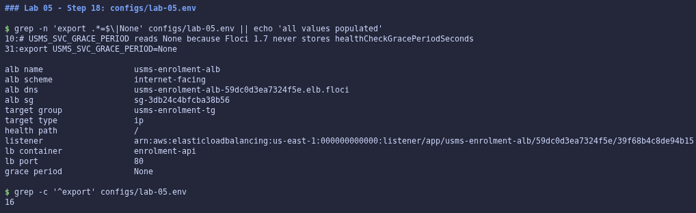

 

#### Step 19: Commit

Staged by explicit path with nothing under `outputs/`, and committed together with Lab 04.

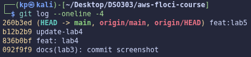

 

#### Section 8.1: `verify-lab-05.sh`

Built verbatim from the lab, except for the same one-line `outputs/.gitkeep` fix as Lab 04. Result: **`PASS=47 FAIL=2`**. Both failures stem from a single Floci limitation, `healthCheckGracePeriodSeconds` not being stored:

- the grace-period check, which the lab lists as benign;
- the env-file `None` check that follows from it.

Every other check passes, including the cutover, both AZs, `ip` target type, the health check, the deregistration delay, the rule and the single deployment.

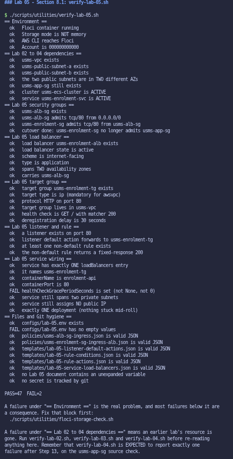

 

#### Section 8.2: `lab-05-cleanup.sh`

Built verbatim from the lab. `bash -n` reported `syntax OK - do NOT run it`, and it was **not** run.

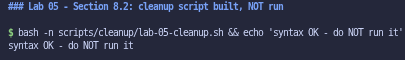

 

#### Independent exercises

All five are documented in `labs/lab-05-ecs-alb/exercises.md`:

1. `usms-results-tg` plus a priority-20 rule; `/results` really returned `503` with no targets.
2. `verify-lab-04.sh` repaired to assert the property (one named source group, no CIDR) and that the web tier is no longer a source: `PASS=39 FAIL=0`, with two negative tests.
3. `usms-lb-report.sh`, giving identical output from two directories, including a default-only listener.
4. The security officer's exposure review: internal versus internet-facing, an exposure table, about USD 24/month for the ALB, the HTTPS plan, and the Exercise 1 objects deleted in dependency order.
5. `usms-resource-label.sh` built with parameter expansion, the label recorded, a readiness file for Lab 06, and a measured **38.5 s** capacity-add time.

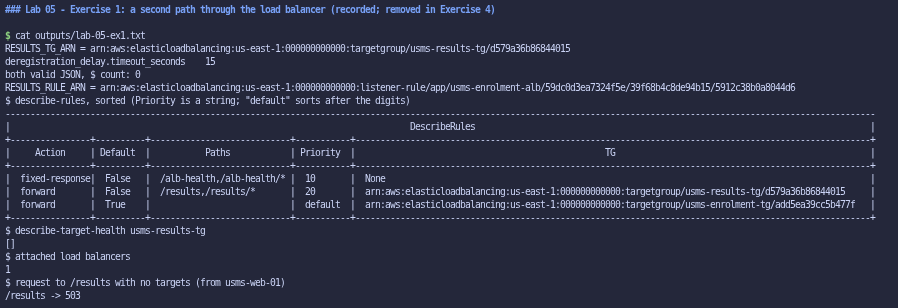
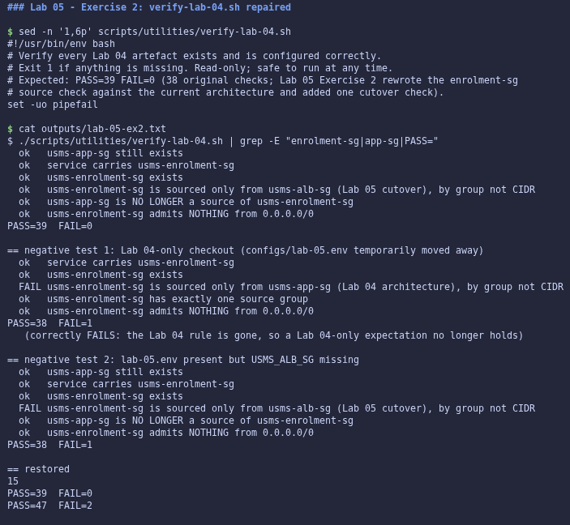
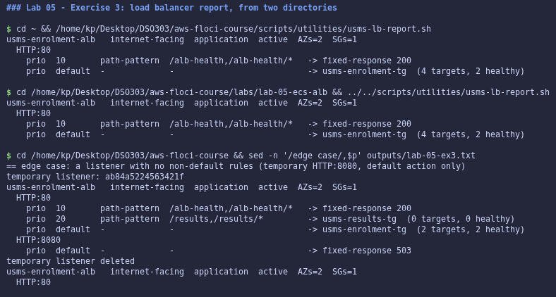
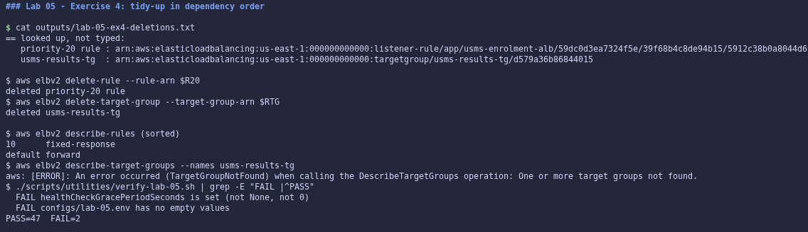
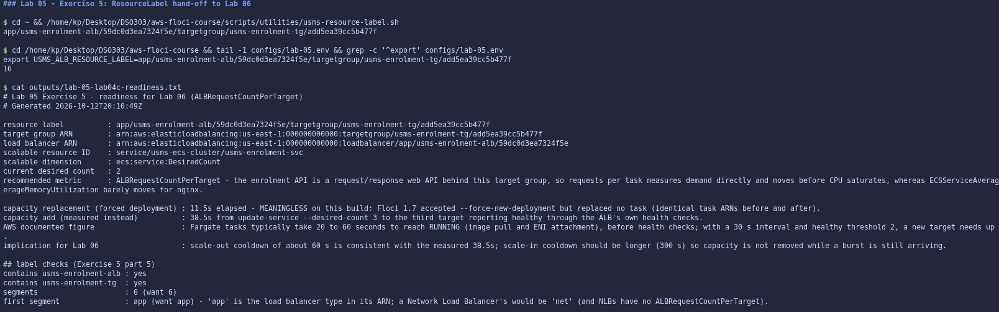

---

## 6. Results and Evidence

### 6.1 CLI Output

**Screenshot 1: targets registered by the service, healthy (Checkpoint 4, Step 11)**

*Image Source: `aws-floci-course/screenshots/lab5/s11.png`*

 

**Screenshot 2: a real HTTP 200 through the load balancer (Step 12)**

*Image Source: `aws-floci-course/screenshots/lab5/s12.png`*

 

**Screenshot 3: forced deployment observed (Checkpoint 5, Step 14)**

*Image Source: `aws-floci-course/screenshots/lab5/s14.png`*

 

**Screenshot 4: PERSISTENCE PROVEN across a restart (Checkpoint 7, Step 16)**

*Image Source: `aws-floci-course/screenshots/lab5/s16.png`*

 

All screenshots referenced in Section 5 are stored in `aws-floci-course/screenshots/lab5/`.

### 6.2 AWS Console Verification

Not applicable. Floci is a CLI-only emulator with no web console. Verification used the AWS CLI, plus `docker exec` from `usms-web-01`'s container for the data path.

---

## 7. Analysis and Discussion

All 19 steps, both Section 8 scripts, the three "Your turn" tasks and all five exercises were completed. Section 13.1 is the individual in-class assessment and is done separately.

Verification results:

- `verify-lab-02.sh`: `PASS=36 FAIL=0`.
- `verify-lab-03.sh`: `PASS=36 FAIL=0`.
- `verify-lab-04.sh`: `PASS=39 FAIL=0`, after Exercise 2's repair.
- `verify-lab-05.sh`: `PASS=47 FAIL=2`. Both failures come from one documented Floci limitation.

This build was more capable than the lab anticipated. A real HTTP `200` travelled from the web tier, through the listener and the priority rules, to a task, before the cutover, after it, and after a restart. Real health checks moved targets from `initial` to `healthy`, the service populated the target group itself, and the `/alb-health` rule demonstrably answered without touching a task.

Issues encountered, and how each was resolved:

- **Silent no-ops in the control plane.** `update-service --load-balancers` and `revoke --security-group-rule-ids` both reported success and changed nothing. Both were caught by reading back. Resolved with the lab's recreate fallback and with revoke by `--ip-permissions`.
- **A restart artefact.** After the restart, ECS lost track of two running tasks, which left four targets for a desired count of two. Resolved by deregistering only the orphaned addresses, never a service-owned target, with the evidence kept.
- **Two bugs in the lab's own commands.** The Step 14 polling query and the Step 18 backtick escaping were diagnosed by testing in both bash and zsh, and replaced with equivalents that work.
- **The provided verify script's `.gitkeep` false positive.** Fixed with one line, as in Lab 04.
- **What could not be observed:** `draining`, a rolling replacement and the grace period. Each is recorded as reasoned rather than claimed.

---

## 8. Reflection

**1. What did you learn about this AWS service?**

That the load balancer is four objects with clear jobs, and that the most important design decision is who owns each one. I own the load balancer, listener, rules and the health check configuration; the **ECS service** owns the target group's membership. Once that clicked, the rule "never run `register-targets`" stopped being a rule and became obvious. I also learned how the security groups chain tier to tier (internet → `usms-alb-sg` → `usms-enrolment-sg`), and why the order *build new path, prove it, remove old path* is what makes a migration safe.

**2. What challenges did you encounter?**

Distinguishing "the API said yes" from "it happened". Two calls returned success and did nothing, and one restart left the target group inconsistent with the service. Each time, the answer came from a second read: the per-rule view, the stored service, the actual containers. I also had to read the lab's own commands critically, because two of them fail as written on both shells I tested.

**3. How would you apply this service in a real-world cloud environment?**

As built here, with four additions:

- HTTPS on 443 with an ACM certificate, and port 80 redirecting to it;
- WAF on the listener;
- access logs to S3;
- for a single internal caller like the portal, an **internal** load balancer instead of an internet-facing one.

On a real system I would also update the verification scripts in the same commit as the architectural change, as Exercise 2 did.

**4. What additional concepts or features would you like to explore?**

Weighted forwarding for canary and blue/green releases, ECS deployment circuit breakers that use target health as the rollback trigger, CloudFront in front of the ALB, and `ALBRequestCountPerTarget` scaling in Lab 06 using the `ResourceLabel` built in Exercise 5.

---

## 9. Conclusion

The objectives were achieved. `usms-enrolment-svc` now sits behind `usms-enrolment-alb`:

- an internet-facing Application Load Balancer across two Availability Zones;
- an `ip` target group with a deliberate health check and a 30-second deregistration delay;
- an HTTP listener with a `/alb-health` rule;
- a service that registers and deregisters its own targets;
- a cutover after which only the load balancer can reach the tasks.

The configuration survives a restart, a real request was served end to end, and `configs/lab-05.env` (16 exports, including the `ResourceLabel`) hands Lab 06 everything its request-count scaling policy needs.

Key concepts learned: the four ELB objects and where the health check lives; why Fargate needs `ip` targets; target health states and how they differ from ECS health; draining and the timers around a stopping task; listener rule priority; and group-to-group security chaining. Skills developed include safe cutovers, honest separation of observed from reasoned evidence, and diagnosing emulator no-ops by reading back from a second angle.

---

## 10. Appendix

| Item | Path |
|---|---|
| ALB security group rules | `aws-floci-course/policies/usms-alb-sg-ingress.json`, `usms-alb-sg-ingress-https.json` |
| Enrolment SG rule for the ALB | `aws-floci-course/policies/usms-enrolment-sg-ingress-alb.json` |
| Listener, rule and service documents | `aws-floci-course/templates/lab-05-*.json` |
| Generated names and ARNs | `aws-floci-course/configs/lab-05.env` |
| Exercises write-up | `aws-floci-course/labs/lab-05-ecs-alb/exercises.md` |
| Lab 06 readiness file | `aws-floci-course/labs/lab-05-ecs-alb/lab06-readiness.txt` |
| Notes, support path, limitations, review questions | `aws-floci-course/notes/lab-05-notes.md` |
| Scripts | `aws-floci-course/scripts/utilities/verify-lab-05.sh`, `usms-lb-report.sh`, `usms-resource-label.sh`; `verify-lab-04.sh` (repaired) |
| Cleanup script (not run) | `aws-floci-course/scripts/cleanup/lab-05-cleanup.sh` |
| Evidence files (git-ignored) | `aws-floci-course/outputs/lab-05-*` |
| All screenshots | `aws-floci-course/screenshots/lab5/` |

---

## Submission Checklist

- [x] Student information completed
- [x] Objectives stated
- [x] Introduction provided
- [x] Real-world use case described
- [x] Tools listed
- [x] System design included
- [x] Implementation documented
- [x] CLI outputs included
- [ ] Console screenshots attached *(not applicable: Floci is CLI-only, no web console)*
- [x] Analysis completed
- [x] Reflection completed
- [x] Conclusion written
- [x] Appendix attached
