# AWS Practical Laboratory Report

**Student Name:** Kinley Palden

**Student ID:** 02230287

**Course:** DSO303

**Lab Number / Title:** Lab 06: Implementing Auto Scaling for an ECS-Based Application

**Date:** 2026-10-14

---

## 1. Aim / Objective

To put `usms-enrolment-svc` under Application Auto Scaling. The work covers:

- registering the service as a scalable target (min 2, max 10) and reading the service-linked role that writes `desiredCount`;
- adding CPU and `ALBRequestCountPerTarget` target tracking policies, a step scaling policy driven by a custom CloudWatch alarm, and two scheduled actions;
- firing the alarm to test whether something other than me moves `desiredCount`;
- suspending and resuming scaling;
- proving the configuration survives a restart, and recording it in `configs/lab-06.env`.

---

## 2. Introduction

**Application Auto Scaling** is the AWS service that scales resources other than EC2 instances. For ECS it changes exactly one value: a service's `desiredCount`. A **scalable target** registers the address `ecs` + `service/<cluster>/<service>` + `ecs:service:DesiredCount`, together with a floor and a ceiling. Three mechanisms decide the number:

- **Target tracking** keeps a metric near a target value. Application Auto Scaling creates and owns two CloudWatch alarms for each policy.
- **Step scaling** adds or removes capacity in steps, driven by an alarm you write.
- **Scheduled actions** move the floor and ceiling at set times. This is the only mechanism that can act *before* a known spike.

Every reactive decision comes from a **CloudWatch alarm**, and is therefore always several minutes late. Scaling can be **suspended** per direction without deleting anything. ECS, the target group and the load balancer from Labs 04 and 05 do everything that happens after the number changes.

This lab ran on **Floci 1.7.0**. It stores and persists the whole scaling configuration, but does **not run the scaling loop**: alarms are not evaluated or acted on, floors are not enforced, and scheduled actions are not supported. The lab was therefore completed on **support path B (control plane only)**, with the wiring proven link by link.

---

## 3. Use Case

Auto scaling keeps a service's capacity matched to demand: enough tasks to keep latency acceptable during a rush, and few enough to avoid paying for idle capacity overnight. Typical uses:

- web APIs scaled on requests per target;
- workers scaled on queue depth;
- batch services scaled on CPU;
- scheduled pre-warming before predictable events such as a sale, a broadcast or an enrolment opening.

For USMS, the enrolment API must survive the burst when registration opens while running at its two-task baseline the rest of the time. This lab gives it:

- a CPU policy;
- a request-count policy built on Lab 05's target group;
- a queue-depth step policy;
- a morning pre-warm and an evening release, all within a 2..10 envelope.

---

## 4. System Architecture / Design

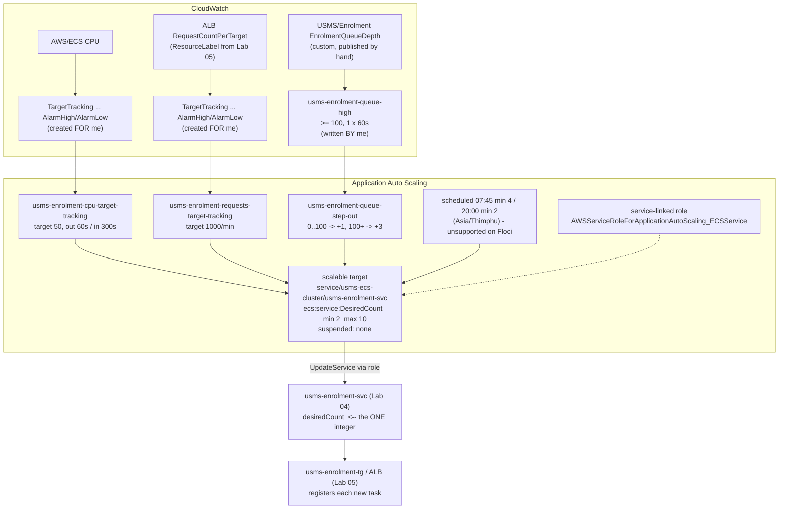

*Image Source: Mermaid diagram authored for this report from the lab's Section 5 architecture.*

---

## 5. Implementation Procedure

All commands were run with AWS CLI v2.36 against Floci from `aws-floci-course/`, continuing from Labs 01 to 05. Labs 04 and 05 had already been committed and pushed, with screenshots, before this lab changed anything.

 

#### Step 1: Resume the environment and load six env files

All fourteen values were present. `baseline desired` is 2. The `grace period` reads `None`, because Floci never stores it (recorded in Lab 05), and that changes Step 12's arithmetic only on paper.

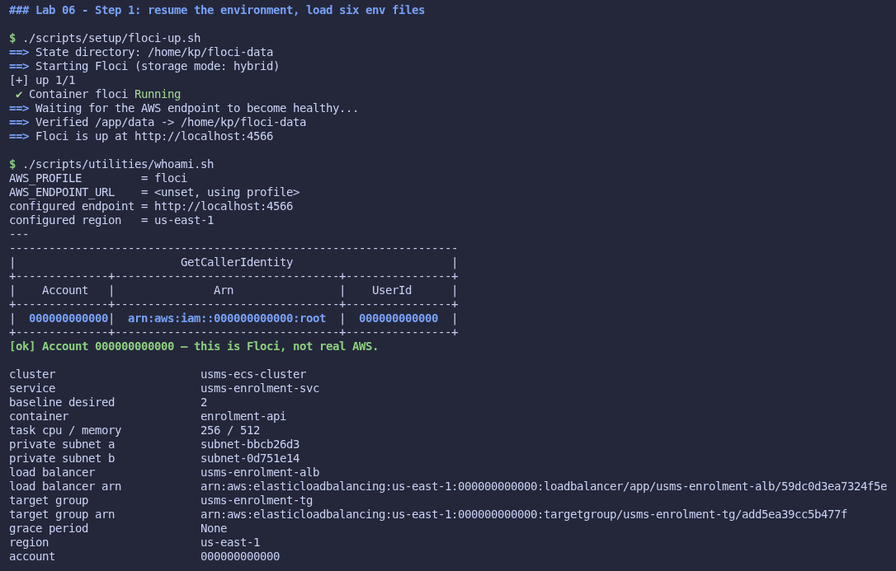

 

#### Step 2: Confirm Labs 02 to 05 are intact

- Labs 02 and 03: `PASS=36 FAIL=0`.
- Lab 04: `PASS=39 FAIL=0`, after Lab 05 Exercise 2, so there is "no failures in 04".
- Lab 05: `PASS=47 FAIL=2`, its two documented grace-period failures. This was saved to `outputs/lab-06-pre-verify-05.txt`.
- The service is at baseline: desired 2, running 2, 1 deployment, 1 load balancer.

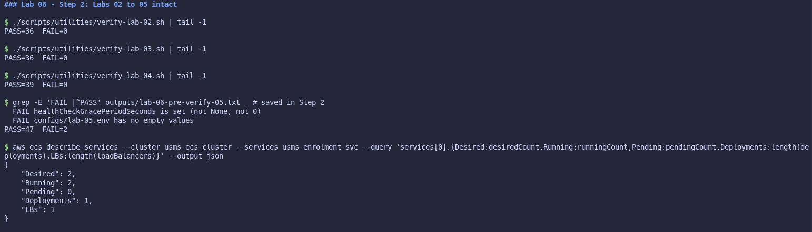

 

#### Step 3: Probe support (Checkpoint 1)

Most calls answered, but `describe-scheduled-actions` and `describe-scaling-activities` returned `UnsupportedOperation`. Step 12 then confirmed **path B**: objects are created and describable, but nothing fires. This is recorded at the top of `notes/lab-06-notes.md`.

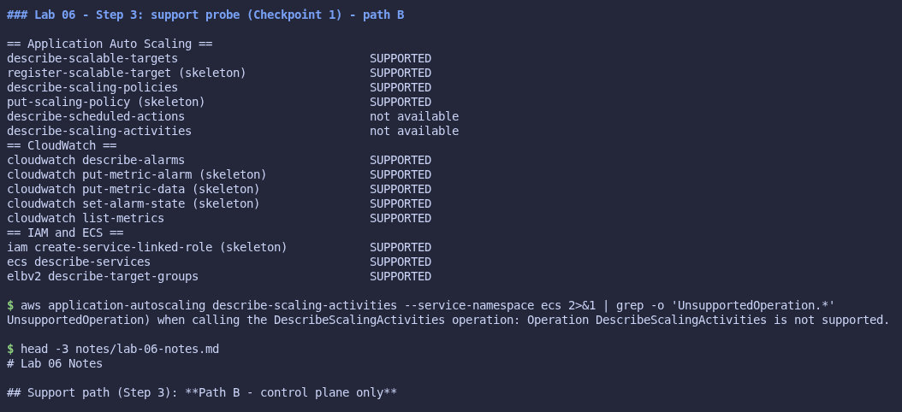

 

#### Step 4: The service-linked role

`create-service-linked-role --aws-service-name ecs.application-autoscaling.amazonaws.com` created **`AWSServiceRoleForEcsApplicationAutoscaling`**. It has the correct `/aws-service-role/…` path and trust principal, but no permissions policy, and it is not the name AWS uses. `get-role` on the real name, `AWSServiceRoleForApplicationAutoScaling_ECSService`, returned `NoSuchEntity`. This is recorded as a Floci limitation.

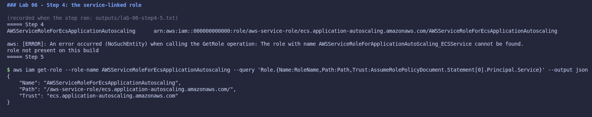

 

#### Step 5: Register the scalable target

The resource ID was derived from the service ARN with `${SVC_ARN##*:}` and validated: 3 segments, first segment `service`. It matches Lab 05's readiness file.

The registration returned a `ScalableTargetARN`. The read-back shows namespace `ecs`, `service/usms-ecs-cluster/usms-enrolment-svc`, `ecs:service:DesiredCount`, min 2, max 10, and all three suspension switches `false`. `RoleARN` was filled in with the real AWS role name, even though that role doesn't exist on this build. `desiredCount` stayed 2, because the service was already inside the bounds.

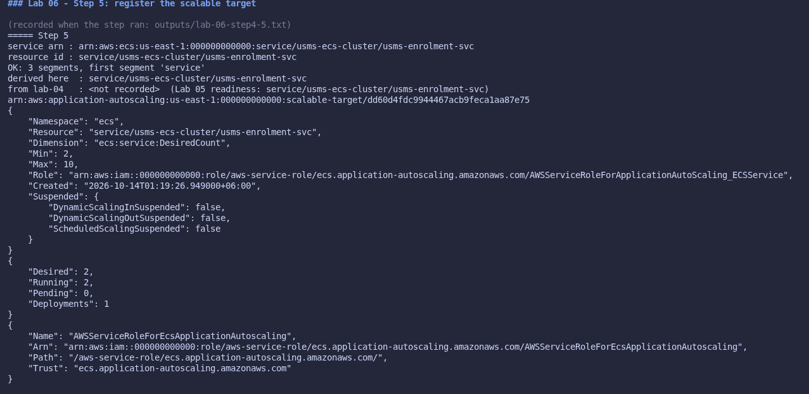

 

#### Step 6: Re-registration (Checkpoint 2)

Registering with only `--max-capacity 12` gave `2 12`: the omitted minimum was preserved. Putting it back gave exactly **one** row at 2 / 10.

**Your turn:** registering `--min-capacity 5` while two tasks ran should have raised `desiredCount` to 5 immediately. On Floci it **stayed at 2** for 40 seconds, because Floci does not enforce the floor, and `describe-scaling-activities` is unsupported. The answers to (a) and (b) are in the notes. The floor was restored to 2.

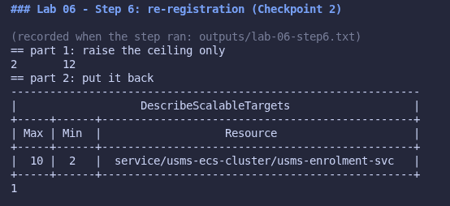
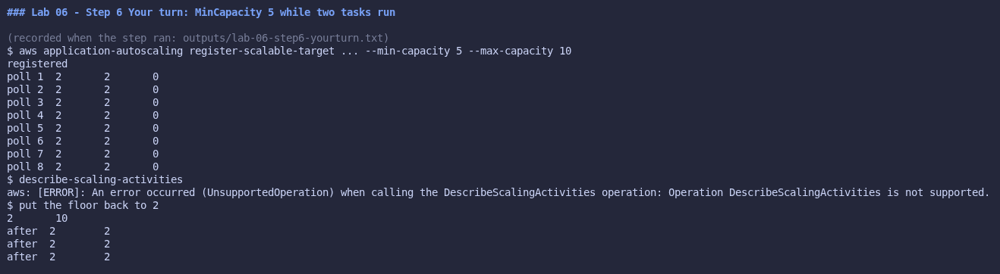

 

#### Step 7: CPU target tracking policy

`templates/lab-06-target-tracking-cpu.json` (quoted heredoc, zero `$`) produced `usms-enrolment-cpu-target-tracking`: target 50, scale-out cooldown 60, scale-in cooldown 300, `DisableScaleIn false`. Two managed alarms appeared that I never created.

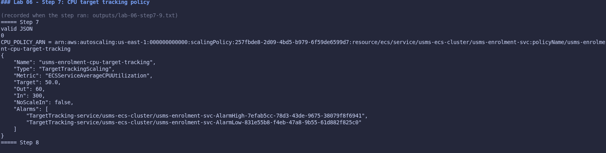

 

#### Step 8: The managed alarms

- `AlarmHigh`: `GreaterThanThreshold`, 60 s × **3**.
- `AlarmLow`: `LessThanThreshold`, 60 s × **15**.
- Both are `INSUFFICIENT_DATA`, and both have one action, which is exactly `$CPU_POLICY_ARN`.

Floci differences:

- the metric name is the predefined type rather than `CPUUtilization`;
- there are no dimensions;
- both thresholds are 50 (no dead band).

**Your turn:** 180 s + about 0 + about 40 s + 60 s ≈ **280 s** before a third task serves (worked in the notes).

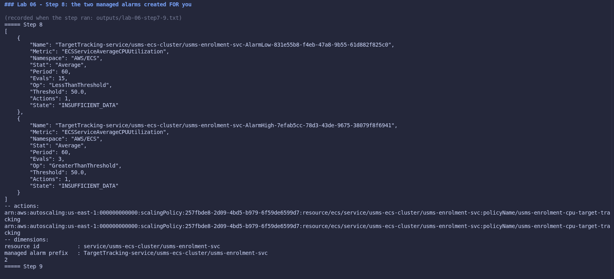

 

#### Step 9: Request-count policy (Checkpoint 3)

The `ResourceLabel` came from Lab 05 Exercise 5 and matched the API. It is validated: 6 segments, `app` first, `targetgroup` fourth. `templates/lab-06-target-tracking-requests.json` (unquoted heredoc, zero `$`) created `usms-enrolment-requests-target-tracking` at 1000 requests per target per minute. There are now two policies with two alarms each, so **4** managed alarms.

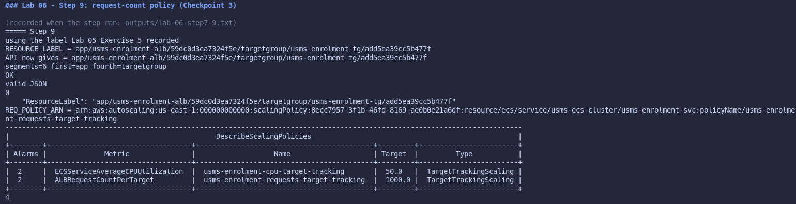

 

#### Step 10: Step scaling and the alarm that drives it

I published `USMS/Enrolment EnrolmentQueueDepth` (3, 5, 4), and `list-metrics` shows it with `Service=enrolment`. `templates/lab-06-step-scaling-out.json` gives `ChangeInCapacity`, `Average`, cooldown 60, with 0..100 → +1 and 100+ → +3 (open-ended). The policy was created first, then `usms-enrolment-queue-high` (≥ 100, 1 × 60 s) with `AlarmActions` set to the step policy ARN.

Floci did not store `TreatMissingData` (`null`), and the policy's `Alarms` list stays empty: there is no back-link.

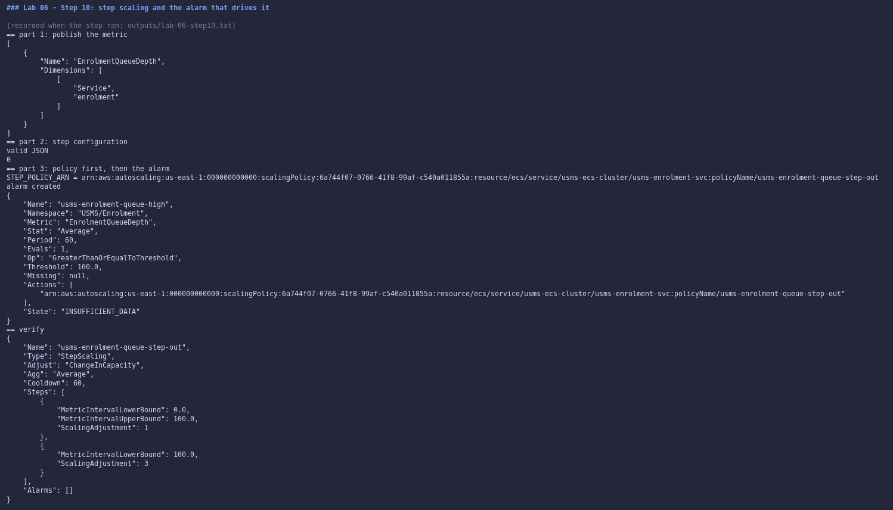

 

#### Step 11: Scheduled actions (Checkpoint 4)

`put-scheduled-action` returned **`UnsupportedOperation`**, both with `--timezone Asia/Thimphu` and in the UTC fallback, so neither scheduled action, nor the `at()` "Your turn", could be created. The exact commands are recorded in the notes as the real-AWS configuration, along with the answer to the "Your turn" question about what an `at()` action leaves behind.

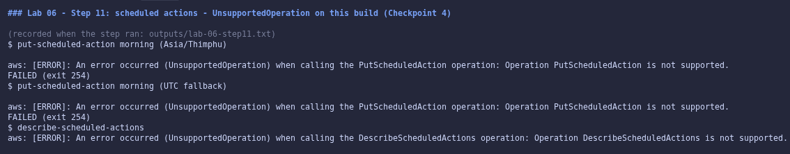

 

#### Step 12: Fire the alarm (Checkpoint 5)

The prediction was a breach of 160, giving +3 and a desired count of 2 → 5.

1. The metric was pushed to 260. `get-metric-statistics` shows `Average 260.0`, so the data is stored.
2. The alarm stayed `INSUFFICIENT_DATA` / `Unchecked` for two minutes; Floci never evaluates it.
3. `set-alarm-state ALARM` succeeded, and Floci logged the state change, but **no action was invoked**. `desiredCount` stayed 2 across ten polls, and `describe-scaling-activities` is unsupported.
4. The **fallback proof** (`outputs/lab-06-scaling-proof.txt`) holds link by link:
   - alarm ≥ 100, in `ALARM`;
   - `AlarmActions` is exactly the step policy ARN (equality checked);
   - that ARN is `usms-enrolment-queue-step-out` on this resource and dimension;
   - a breach of 160 selects **+3**;
   - the bounds are 2..10;
   - the current count is 2.

The missing link is **alarm state → policy invocation**. Back to baseline: alarm to `OK`, metric pushed down first, then the count set to 2.

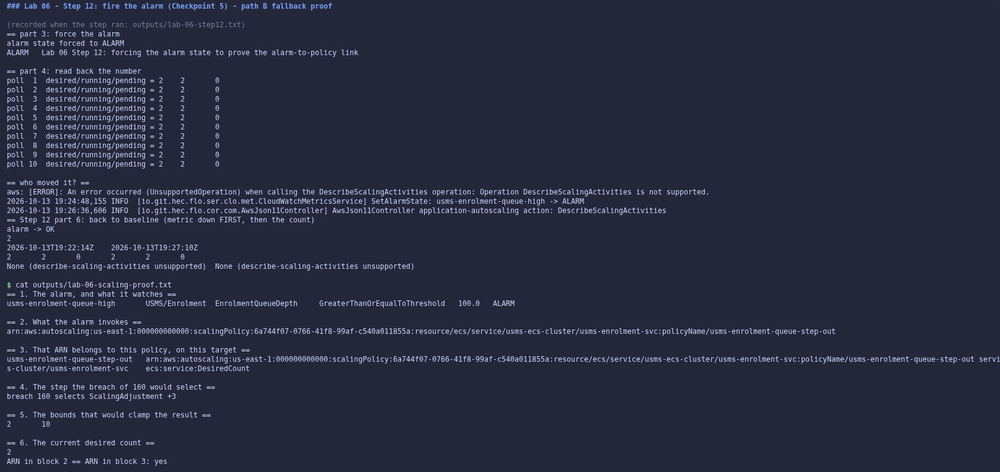

 

#### Step 13: Suspend and resume (Checkpoint 6)

`templates/lab-06-suspended-state.json` suspended scale-in only, giving one `true` and two `false`, with the bounds unchanged. All three policies and four managed alarms were untouched. Resuming gave three `false`, and `SuspendedState.*` piped to `grep -ci true` printed **0**.

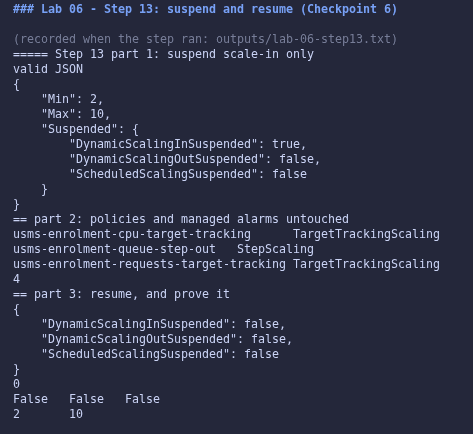

 

#### Step 14: Restart persistence (Checkpoint 7)

Every identifier was re-derived from the API: the resource ID from the service ARN, the policies by name fragment and by type, and the alarm by prefix. The result is **`PERSISTENCE PROVEN`**: the target, its bounds and switches, all three policies with their configurations, and the custom alarm, with four managed alarms still present. Scheduled actions are absent from both files because the build cannot create them.

The restart also disturbed runtime state:

- All four EC2 instances came back `stopped`. I started them one at a time.
- The target group held two addresses of tasks that no longer existed (`Target.FailedHealthChecks`). I deregistered only those two addresses, which had no container behind them.

Afterwards the data path returned `200` again.

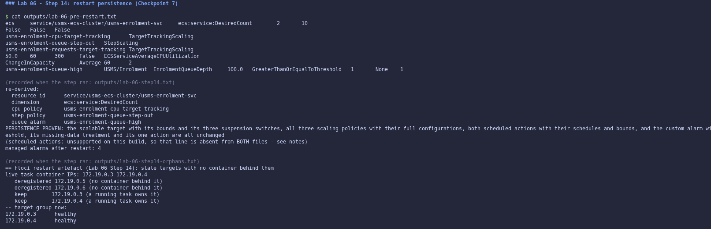

 

#### Step 15: Close the loop

All seven blocks were collected:

- the alarms;
- the three policies;
- the target at 2..10;
- the service at 2/2 on `usms-enrolment:2`;
- the two private subnets with `DISABLED`;
- two healthy targets registered by the service;
- block 7: `usms-enrolment:2`, **1** load balancer, **1** deployment, so this lab changed nothing below the scaling layer.

The nine-line chain is written out in the notes. This lab owns three of the nine lines.

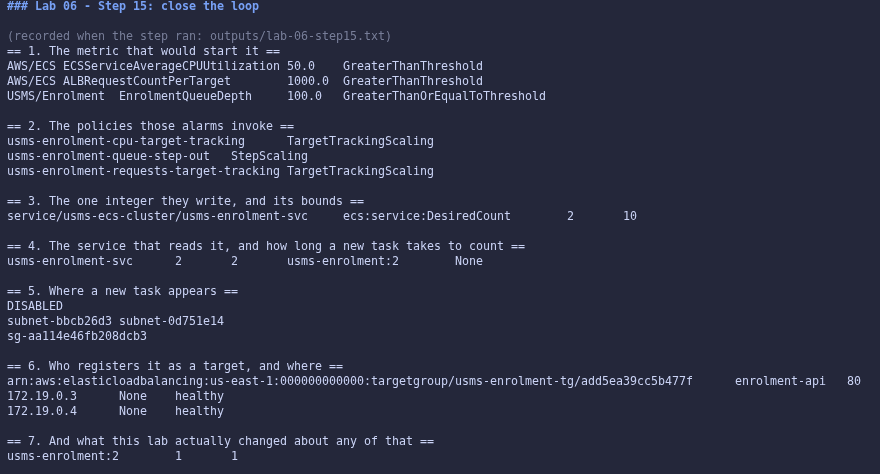

 

#### Step 16: `configs/lab-06.env`

The lab's `awk -F: '{print \$NF}'` keeps its backslash inside the heredoc, and awk rejected it, so the resource ID came out empty. It was derived with Step 5's own `${SVC_ARN##*:}` instead, and a comment in the file explains why. The result is `all values populated`, bounds `2 .. 10`, the resource ID matching the API, and **22** exports (24 after Exercise 5).

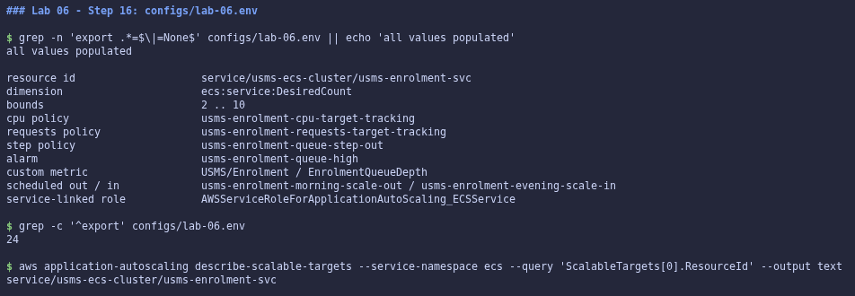

 

#### Step 17: Commit, and repair the stale hints

`lab-04-cleanup.sh` already said `lab-06-cleanup.sh`. In `lab-05-cleanup.sh`, the lab's blanket `lab-04` → `lab-06` replacement would also have broken three correct lines ("Run BEFORE lab-04", "lab-04 may now run"). So only the **three stale hints** were changed, with a backup kept outside the repository, and both scripts still pass `bash -n`.

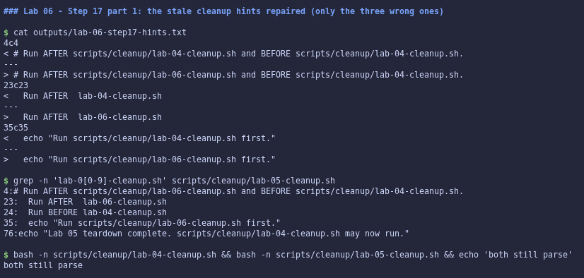

 

#### Section 8.1: `verify-lab-06.sh`

Built verbatim from the lab, with the same one-line `outputs/.gitkeep` fix as Labs 04 and 05. Result: **`PASS=39 FAIL=3`**. All three failures are the scheduled-action checks, failing because the API is unsupported (the lab's benign table). Every other check passes: one target, the correct bounds, no suspension left on, both policies with asymmetric cooldowns, an open-ended top step, the alarm invoking the step policy, managed alarms present, desired 2 inside the bounds, and one deployment. `verify-lab-05.sh` output is byte-identical to Step 2's capture.

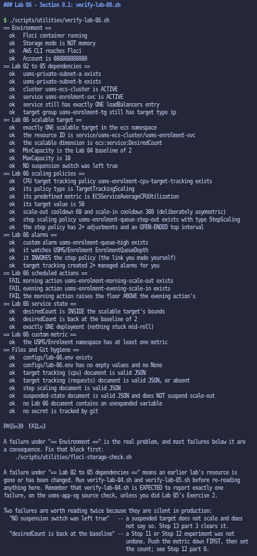

 

#### Section 8.2: `lab-06-cleanup.sh`

Built verbatim from the lab. `bash -n` reported `syntax OK - do NOT run it`, and it was **not** run.

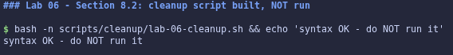

 

#### Independent exercises

All five are documented in `labs/lab-06-ecs-autoscaling/exercises.md`:

1. A scale-out-only memory policy. Floci created 6 managed alarms, not AWS's 5.
2. A scale-in step policy and a low alarm, with the signs explained, the unreachable step identified, and both deleted in order.
3. `usms-scaling-report.sh`, with computed `AT-FLOOR`/`FROZEN`/`PINNED` verdicts and identical output from two directories.
4. A capacity plan: about 4.7 minutes to react, the ceiling of 10 = 167 req/s against a 667 req/s peak, 500 usable addresses, a scheduled plan, about USD 22.67 extra, and the memory policy deleted.
5. `usms-scaling-history.sh` (12,007-byte JSON), a measured **7.4 s to running / 62.8 s to serving**, 24 exports, and a Lab 10 readiness file with `head-bucket` returning 404 / exit 254.

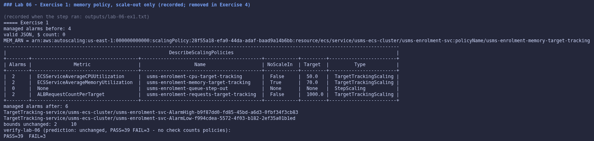
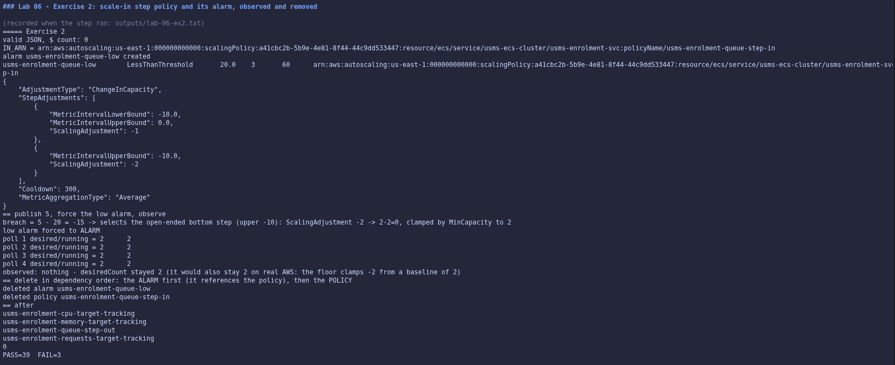
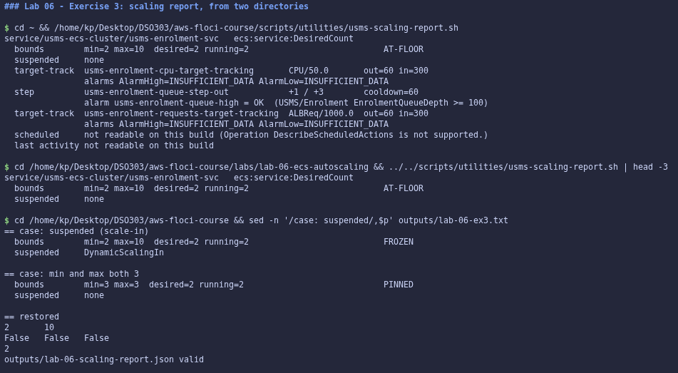
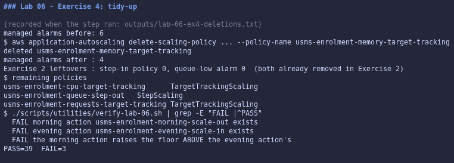
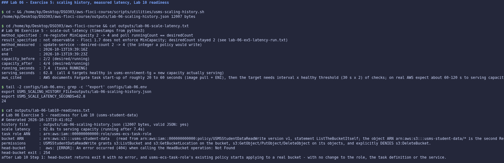

---

## 6. Results and Evidence

### 6.1 CLI Output

**Screenshot 1: two target tracking policies and four managed alarms (Checkpoint 3, Step 9)**

*Image Source: `aws-floci-course/screenshots/lab6/s9.png`*

 

**Screenshot 2: the alarm fired and the wiring proven (Checkpoint 5, Step 12)**

*Image Source: `aws-floci-course/screenshots/lab6/s12.png`*

 

**Screenshot 3: PERSISTENCE PROVEN (Checkpoint 7, Step 14)**

*Image Source: `aws-floci-course/screenshots/lab6/s14.png`*

 

**Screenshot 4: `verify-lab-06.sh` (Section 8.1)**

*Image Source: `aws-floci-course/screenshots/lab6/s18.png`*

 

All screenshots referenced in Section 5 are stored in `aws-floci-course/screenshots/lab6/`.

### 6.2 AWS Console Verification

Not applicable. Floci is a CLI-only emulator with no web console.

---

## 7. Analysis and Discussion

The scaling configuration is complete and verified, except for the scheduled actions this build cannot create:

- a scalable target at 2..10;
- CPU and request-count target tracking with asymmetric cooldowns;
- a queue-depth step policy with its own alarm;
- suspension exercised and cleared;
- persistence across a restart.

`verify-lab-06.sh` reports `PASS=39 FAIL=3`, with all three failures traced to `UnsupportedOperation`. Labs 02 to 05 are unchanged, and `verify-lab-05.sh`'s output is identical to the pre-lab capture.

The central finding is that **this build models the scaling loop without closing it**. That made the lab's own warning concrete: an ARN returned, an alarm in `ALARM` and a policy that lists the right adjustments together prove *configuration*, not *behaviour*. I did not claim a scaling activity. Instead I proved each link (metric → alarm → policy ARN → step selected → bounds) and named the missing one, alarm-to-policy invocation. I then measured the part Floci does run for real (ECS starting tasks and the load balancer health-checking them): **7.4 s to running and 62.8 s to serving**. That second number is Section 4's lateness argument made visible.

Issues encountered and how each was resolved:

- **Wrong service-linked role name**, recorded rather than worked around, since nothing on Floci assumes it.
- **Floors not enforced and alarms not acted on** (path B): the fallback proof was used, and the evidence was kept honest.
- **Scheduled actions unsupported**: the real-AWS commands are specified in the notes and in the Exercise 4 plan.
- **A restart that stopped every EC2 instance and left dead targets**: instances were restarted and only the dead targets were deregistered.
- **Three defects in the lab's own commands**, each found by testing rather than trusting:
  - Step 16's escaped `awk` field reference;
  - Step 17's over-broad replacement, which would have broken three correct cleanup hints;
  - the verify script's `.gitkeep` false positive.

---

## 8. Reflection

**1. What did you learn about this AWS service?**

That Application Auto Scaling, for all its objects, writes exactly one integer, and everything else (tasks, ENIs, target registration, health checks) is the behaviour Labs 04 and 05 already built. I learned the difference between the alarms I own and the ones a policy owns. I also learned that scale-out takes the largest request while scale-in needs every policy's agreement. Most of all, I learned that reactive scaling is always minutes late: the minimum capacity and scheduled actions are what handle a spike, not the policies.

**2. What challenges did you encounter?**

Distinguishing a configured system from a working one. Floci accepted every policy and alarm, and even let me force an alarm into `ALARM`, yet nothing scaled. The temptation is to treat a clean `describe` as success. Building the six-block chain showed exactly which link was missing. I also had to read the lab's own commands critically again, because a blanket search-and-replace would have quietly broken correct lines in a cleanup script.

**3. How would you apply this service in a real-world cloud environment?**

Request-count target tracking as the primary signal, after a load test establishes the per-task target value. A floor sized for the first minutes of a spike. Scheduled actions for every known event, each deployed together with its own removal and floor reset. Step scaling only for metrics without a set point, like queue depth, with SNS notification on the same alarm. A monitor on `MinCapacity` and `SuspendedState`, so a forgotten floor or a left-on suspension is caught.

**4. What additional concepts or features would you like to explore?**

Predictive scaling (EC2 Auto Scaling only), the `AWS/ApplicationELB` and Container Insights metrics on a real account, CloudWatch alarm actions to SNS (the CloudWatch lab), and how the CloudFormation lab declares this whole configuration as a template.

---

## 9. Conclusion

The objectives were achieved as far as the emulator allows:

- `usms-enrolment-svc` is a scalable target (2..10);
- CPU and `ALBRequestCountPerTarget` target tracking, a queue-depth step policy and its alarm are in place;
- suspension was exercised and cleared;
- the configuration survives a restart;
- `configs/lab-06.env` (24 exports) records it for the CloudWatch and CloudFormation labs.

The two scheduled actions are specified but could not be created on Floci 1.7. Scaling *behaviour* (an alarm moving `desiredCount`) was not observable and is not claimed; the wiring that would produce it is proven link by link.

Key concepts learned: the scalable target's three-part address; target tracking versus step scaling versus scheduled scaling; managed versus customer alarms; the scale-out/scale-in asymmetry; suspension; and why reactive scaling is late. Skills developed include deriving identifiers from the API, proving a control loop without being able to run it, capacity planning with stated assumptions, and catching defects in supplied commands before they did damage.

---

## 10. Appendix

| Item | Path |
|---|---|
| Policy configurations | `aws-floci-course/templates/lab-06-target-tracking-cpu.json`, `-requests.json`, `-memory.json`, `lab-06-step-scaling-out.json`, `-in.json` |
| Suspension runbook artefact | `aws-floci-course/templates/lab-06-suspended-state.json` |
| Generated names and ARNs | `aws-floci-course/configs/lab-06.env` |
| Exercises write-up | `aws-floci-course/labs/lab-06-ecs-autoscaling/exercises.md` |
| Lab 10 readiness file | `aws-floci-course/labs/lab-06-ecs-autoscaling/lab10-readiness.txt` |
| Notes, support path, limitations, review questions | `aws-floci-course/notes/lab-06-notes.md` |
| Scripts | `aws-floci-course/scripts/utilities/verify-lab-06.sh`, `usms-scaling-report.sh`, `usms-scaling-history.sh` |
| Cleanup script (not run) | `aws-floci-course/scripts/cleanup/lab-06-cleanup.sh`; hints repaired in `lab-05-cleanup.sh` |
| Evidence files (git-ignored) | `aws-floci-course/outputs/lab-06-*` |
| All screenshots | `aws-floci-course/screenshots/lab6/` |

---

## Submission Checklist

- [x] Student information completed
- [x] Objectives stated
- [x] Introduction provided
- [x] Real-world use case described
- [x] Tools listed
- [x] System design included
- [x] Implementation documented
- [x] CLI outputs included
- [ ] Console screenshots attached *(not applicable: Floci is CLI-only, no web console)*
- [x] Analysis completed
- [x] Reflection completed
- [x] Conclusion written
- [x] Appendix attached
