# AWS Practical Laboratory Report

**Student Name:** Kinley Palden

**Student ID:** 02230287

**Course:** DSO303

**Lab Number / Title:** Lab 07: Deploying a Microservices Application on Amazon EKS

**Date:** 2026-10-16

---

## 1. Aim / Objective

To run USMS as three microservices on Amazon EKS, next to the ECS service from Labs 04 to 06. The work covers:

- creating an EKS cluster and a managed node group in Lab 02's VPC, each with its own IAM role;
- pointing `kubectl` at the cluster and deploying `usms-gateway`, `usms-enrolment` and `usms-results` from declarative manifests;
- proving the services find each other by DNS name, then performing a rolling update, a rollback and three deliberate failure diagnoses;
- using a ConfigMap and a Secret, and showing what a Secret does not protect;
- testing whether the cluster survives a restart, and saving its identifiers to `configs/lab-07.env` for Lab 08.

---

## 2. Introduction

**Amazon Elastic Kubernetes Service (EKS)** runs a managed Kubernetes **control plane** (API server, etcd, scheduler, controllers) that AWS operates, patches and makes highly available, while you supply the **data plane**: EC2 instances in a managed node group, or Fargate. You describe the application with Kubernetes objects:

- **Deployments** keep N copies of a pod alive, through **ReplicaSets**;
- **Services** give those pods one stable name and virtual IP, resolved by CoreDNS;
- **ConfigMaps** and **Secrets** carry configuration;
- **probes** decide readiness and liveness.

IAM joins the two worlds through two roles: a cluster role trusted by `eks.amazonaws.com`, and a node role trusted by `ec2.amazonaws.com`. IRSA can give individual pods their own IAM role. EKS matters because Kubernetes is the de facto portable platform for containers. The same manifests run on any conformant cluster, while AWS removes the hardest part to run yourself, the control plane.

This lab ran on **Floci 1.7.0** on **support path A**. `aws eks create-cluster` starts a **real k3s cluster** in a container, so the Kubernetes half of the lab is genuine. The AWS half (node group, roles, instance types) is stored, not provisioned: Floci's cluster has one k3s node. After the lab I repaired the gaps this left (two joined worker nodes, the load-balancer host ports, and recovery from restarts and reboots); Section 5's "Repairs after the lab" describes each one.

---

## 3. Use Case

EKS is used where an organisation runs many services and wants one platform for all of them. Typical examples:

- microservice back ends for web and mobile applications;
- platforms that must run the same way on-premises and in several clouds;
- machine-learning and batch workloads using the Kubernetes ecosystem (operators, Helm charts, GPU scheduling);
- multi-team platforms where each team gets a namespace.

For USMS, the portal's request path is split into a gateway and two back-end services. When a student registers for a module, the request reaches `usms-gateway`, which forwards `/enrolment/` and `/results/` **by DNS name** to two replicas each of `usms-enrolment` and `usms-results`. The gateway's configuration contains no IP addresses. This lab builds that path inside the cluster; Lab 08 adds autoscaling and exposure to the outside world.

---

## 4. System Architecture / Design

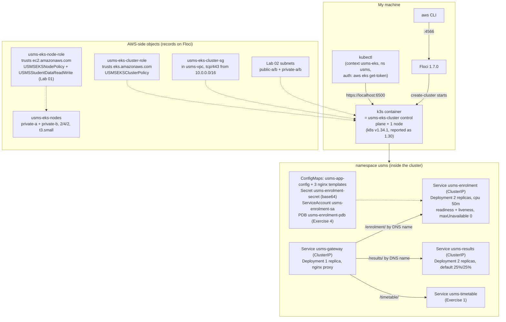

*Image Source: Mermaid diagram authored for this report from the lab's Section 5 architecture, adjusted to what Floci actually ran (one k3s server on port 6500; the two agent nodes were joined later, see "Repairs after the lab").*

---

## 5. Implementation Procedure

All commands were run with AWS CLI v2 and `kubectl` v1.36 against Floci from `aws-floci-course/`, continuing from Labs 01 to 06. Lab 06 had been committed and pushed before this lab changed anything. `kubectl`'s previous context (`kind-dso202`, from another course) was backed up before Step 11 and left intact; Step 11 made `usms-eks` the current context.

 

#### Step 1: Start the environment

Floci was up in `hybrid` mode as account `000000000000`. `verify-lab-02.sh` gave `PASS=36 FAIL=0` and `verify-lab-04.sh` `PASS=39 FAIL=0`. All four subnets were present: `subnet-51dea2ed`, `subnet-56019841` (public) and `subnet-bbcb26d3`, `subnet-0d751e14` (private).

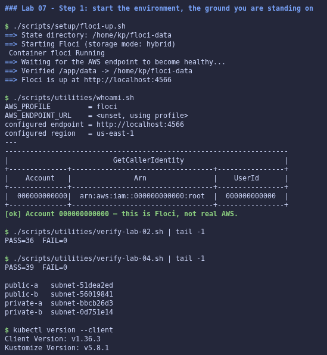

 

#### Step 2: Probe support (Checkpoint 1)

`eks-support-probe.sh` found `eks list-clusters: OK` and `kubectl` installed, so the verdict is **PATH A**. `k3d` is not installed and was not needed. The verdict is recorded at the top of `notes/lab-07-notes.md`.

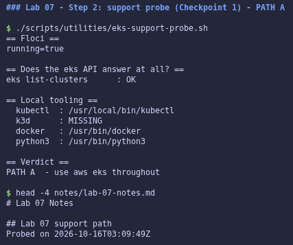

 

#### Step 3: Control plane and data plane

The "Your turn" answer is in the notes. EKS is *not* "ECS with different names", because I own the data plane and a second API. It is *nearly* that, because the control-plane jobs (keep N copies, roll, name them) map one to one.

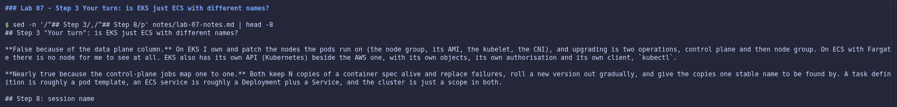

 

#### Steps 4 and 5: Trust and permissions policies

Both trust policies were written with a quoted heredoc: `eks.amazonaws.com` for the cluster role and `ec2.amazonaws.com` for the node role, each with `sts:AssumeRole`. The two local stand-ins for the AWS managed policies were valid JSON:

- the cluster policy has three statements (8 ENI actions, 7 load-balancer actions, and a region `Deny`);
- the node policy has five (kubelet, VPC CNI, ECR, logs scoped to `/usms/eks/*`, and the `Deny`).

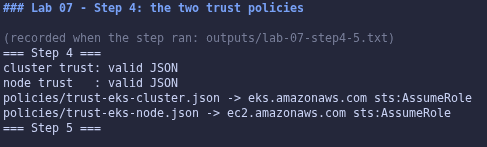
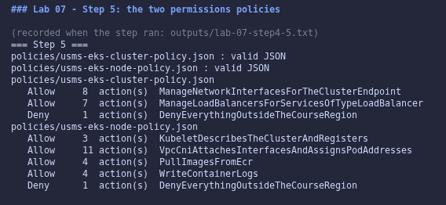

 

#### Steps 6 and 7: Two roles and the cluster security group (Checkpoint 2)

- `usms-eks-cluster-role` trusts `eks.amazonaws.com` and has `USMSEKSClusterPolicy` attached.
- `usms-eks-cluster-sg` (`sg-b478c6286a5a6ce9f`) is in `vpc-1e02eb31` with `443` from `10.0.0.0/16` only.
- `usms-eks-node-role` trusts `ec2.amazonaws.com` and has `USMSEKSNodePolicy` and Lab 01's `USMSStudentDataReadWrite` attached. That policy now has three holders: `usms-ec2-app-role`, `usms-ecs-task-role` and `usms-eks-node-role`. Its ARN was looked up by name.

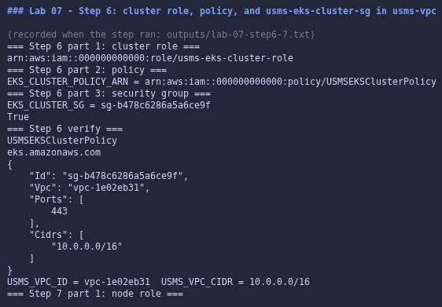
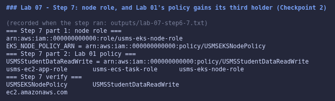

 

#### Step 8: Create the cluster

`templates/lab-07-create-cluster.json` was written with an unquoted heredoc, so it holds the real role ARN, four subnet IDs, the SG and the `_lb_ports_: 8081,8082` tag. I assumed `usms-developer-role` (Floci reports the session as `floci-session`) and ran `create-cluster`, which returned `CREATING`. I then unset the credentials, and `whoami.sh` showed `root` again.

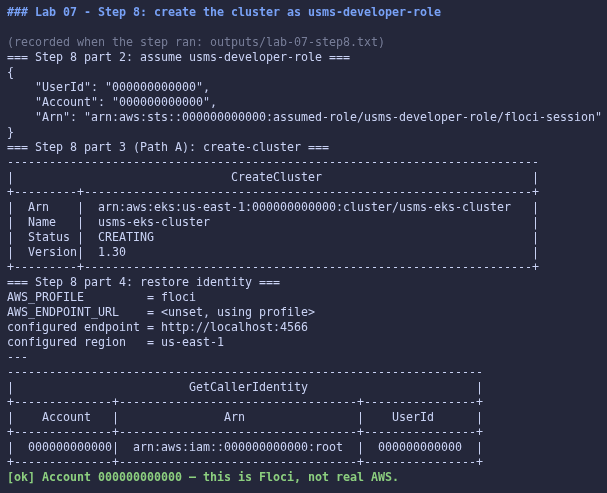

 

#### Step 9: Wait for the cluster

The waiter worked and the cluster was `ACTIVE` in about 30 seconds. `describe-cluster` shows:

- 4 subnets in `vpc-1e02eb31`;
- endpoint `https://localhost:6500` (not the lab's 6443);
- `_lb_ports_` = `8081,8082` first time, with no `tag-resource` needed.

Behind it is a real `rancher/k3s` container. **"Your turn":** `cluster.[version,identity.oidc.issuer]` printed `1.30` and an `https://oidc.eks.us-east-1.amazonaws.com/id/…` URL, so this build does return an issuer (Step 21 shows it cannot be used).

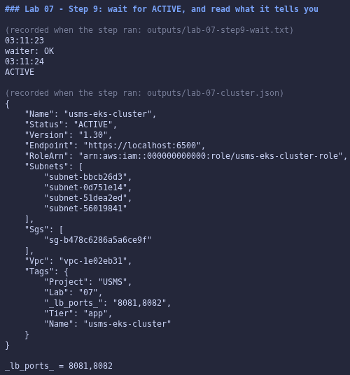
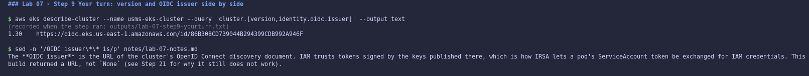

 

#### Step 10: Managed node group (Checkpoint 3)

`usms-eks-nodes` is `ACTIVE` in exactly the two private subnets, min 2 / max 4 / desired 2, role `usms-eks-node-role`, labels `workload=usms tier=app`. It was `ACTIVE` in the create response itself and **no container appeared**: `t3.small` is recorded, not provisioned. This is a Floci limitation, which I later worked around by joining two k3s agent nodes built from this record (see "Repairs after the lab").

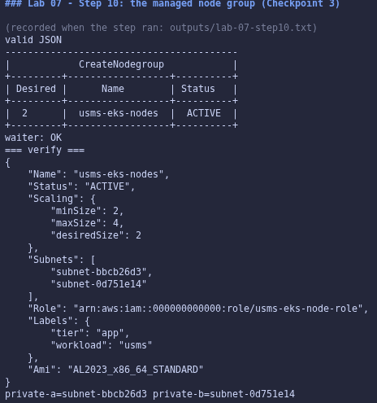

 

#### Step 11: Point `kubectl` at the cluster

`aws eks update-kubeconfig --alias usms-eks` worked, including the `aws eks get-token` exec plugin, so no certificate fallback was needed. `kubectl cluster-info` shows the control plane, CoreDNS and metrics-server. `kubectl get nodes` shows **one** `Ready` node: the k3s server, `v1.34.1+k3s1`, untainted, so pods schedule on it. `auth can-i create deployments --all-namespaces` returned `yes`.

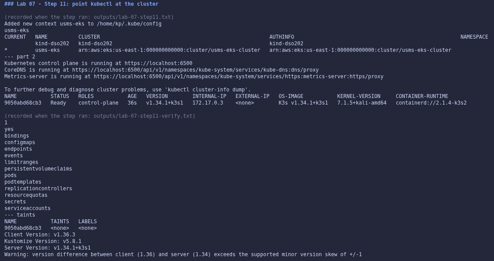

 

#### Step 12: Namespace `usms`

`00-namespace.yaml` was applied, and `set-context --current --namespace=usms` made it the default. The namespace is `Active` with three labels and no resources.

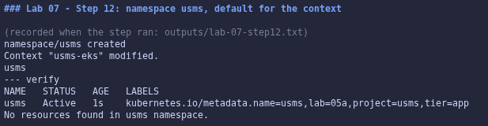

 

#### Step 13: `usms-enrolment` (Checkpoint 4)

The shared ConfigMap has 4 keys. `20-enrolment.yaml` holds the nginx template ConfigMap, the Deployment (2 replicas, requests `50m`/`32Mi`, readiness every 5 s and liveness every 20 s on `/healthz`, `maxUnavailable 0 / maxSurge 1`) and a ClusterIP Service. It rolled out at 2/2 with **two endpoints** and no external IP. A busybox pod got `{"service":"usms-enrolment","pod":"usms-enrolment-6965b8dbbb-xlp5r",…,"version":"1.0.0"}`: the template was processed.

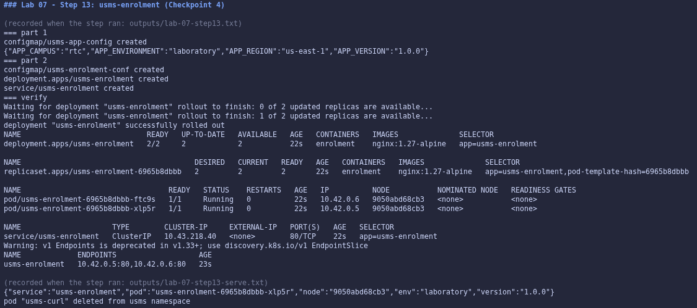

 

#### Steps 14 and 15: `usms-results` and the gateway

`usms-results` is 2/2 with the default strategy (`MAXUNAVAIL 25%` against enrolment's `0`), and both Services have two endpoints. The gateway rolled out, five pods are `Running`, and its log shows `Configuration complete; ready for start up` with no `emerg` lines.

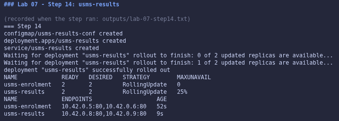
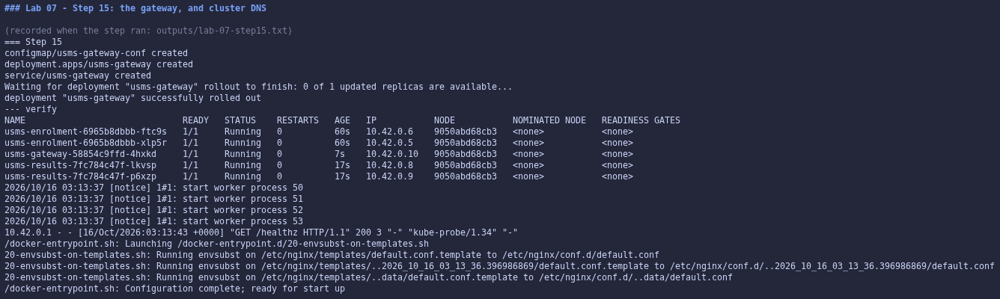

 

#### Step 16: Service discovery (Checkpoint 5)

From inside a pod, both names resolved through CoreDNS (`10.43.0.10`) to their **ClusterIPs** (`10.43.218.40`, `10.43.8.14`), not to pod addresses. The gateway's `/`, `/enrolment/` and `/results/` all answered, and twelve requests were spread **7 / 5** across two enrolment pods.

**Your turn:** I deleted one enrolment pod. A replacement was `Running` within 10 seconds, 20 of 20 requests succeeded, and the new pod answered 14 of them. The **ReplicaSet** created it (`SuccessfulCreate replicaset/usms-enrolment-6965b8dbbb`).

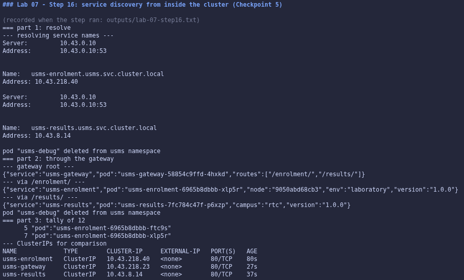
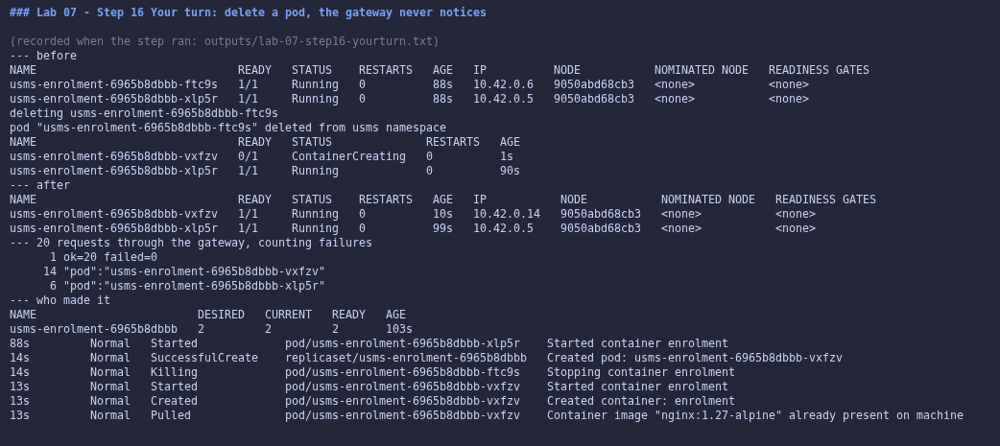

 

#### Step 17: ConfigMap and Secret

`usms-enrolment-secret` was generated with `--dry-run=client -o yaml` into `50-secret.yaml`. I kept it there deliberately, because the values are labelled dummies. `jsonpath` printed `ZmxvY2kt…`, and a plain `base64 -d` printed `floci-dummy-token-not-a-real-secret`: **an encoding, not a lock**.

`kubectl set env --from=secret/…` rolled the Deployment. On kubectl 1.36 it adds per-key `secretKeyRef` entries rather than the `envFrom.secretRef` the lab describes, with the same effect. Inside the container are four `APP_*` and two `ENROLMENT_*` variables, with the token in plain text.

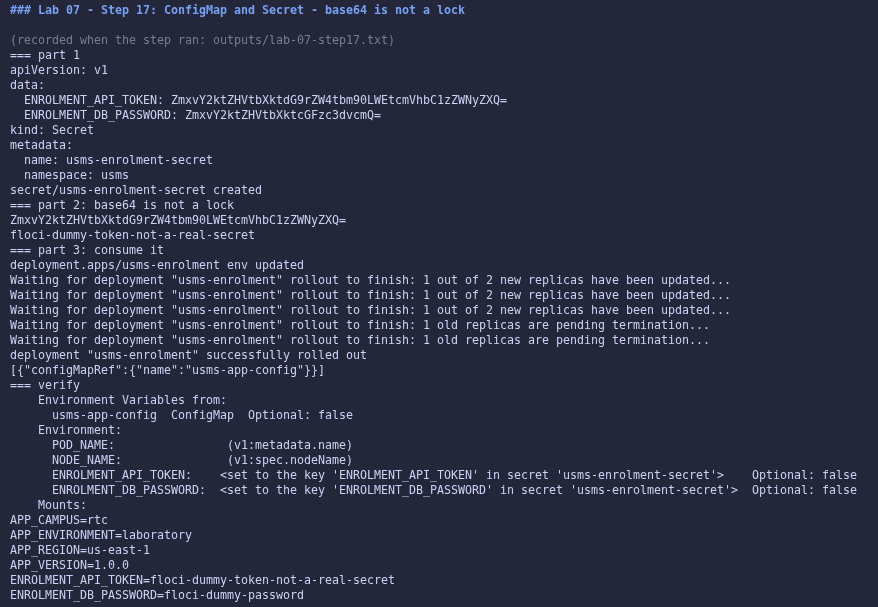

 

#### Step 18: Roll out and roll back (Checkpoint 6)

- `APP_VERSION` was changed to `1.1.0` and applied; the pod **still answered `1.0.0`**.
- `annotate` did not roll (`rollout status` returned in 0.7 s).
- `rollout restart` created a new ReplicaSet, and the pod answered **`1.1.0`**.
- `rollout undo` scaled an older ReplicaSet back up, and the pod **still answered `1.1.0`**: undo reverts the pod template, not the ConfigMap.
- Restoring the ConfigMap and restarting brought it back to `1.0.0`, ending on revision 5. Step 17's `set env` was revision 2, which is why the numbering is not the lab's 3.

**Your turn:** I rolled `usms-results` to `nginx:1.27` and back with `--to-revision=1`. Afterwards there are **two revisions** and the original image. The peak was 3 live pods and the roll never dropped below 2 ready. That is the *same* shape as enrolment's, because at 2 replicas 25% rounds to maxSurge 1 and maxUnavailable 0.

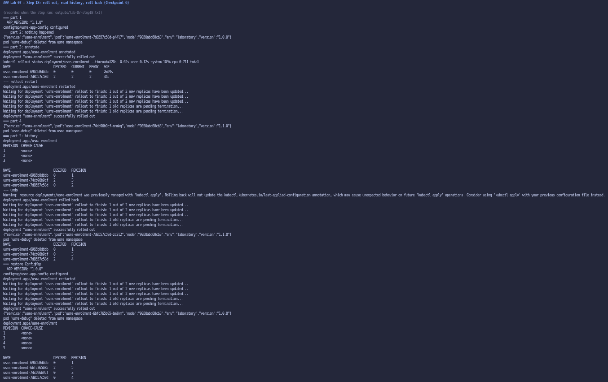
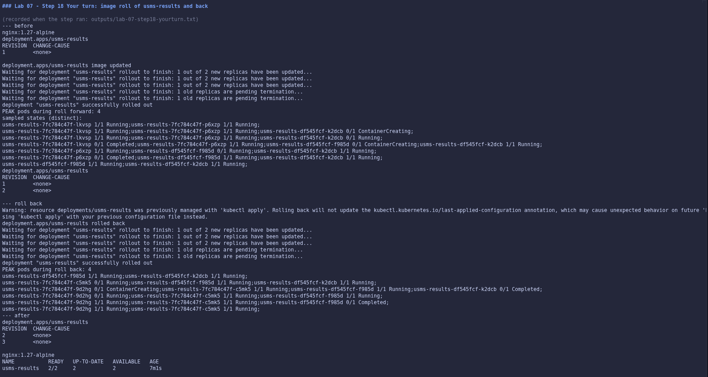

 

#### Step 19: Three failures, diagnosed (Checkpoint 7)

- **`ImagePullBackOff`:** `describe` events show `failed to resolve reference "docker.io/library/nginx:this-tag-does-not-exist": not found`. The **two old pods kept serving**. Fixed with `rollout undo`.
- **`Pending` / `FailedScheduling`:** `0/1 nodes are available: 1 Insufficient cpu, 1 Insufficient memory` for 64 CPUs and 256 Gi.
- **`CrashLoopBackOff`:** `2 (16s ago)` restarts. `logs` and `logs --previous` show `fatal: no database configured`, and `Last State: Terminated, Exit Code 1`.

All three temporary objects were deleted, and `usms-results` is back to 2/2.

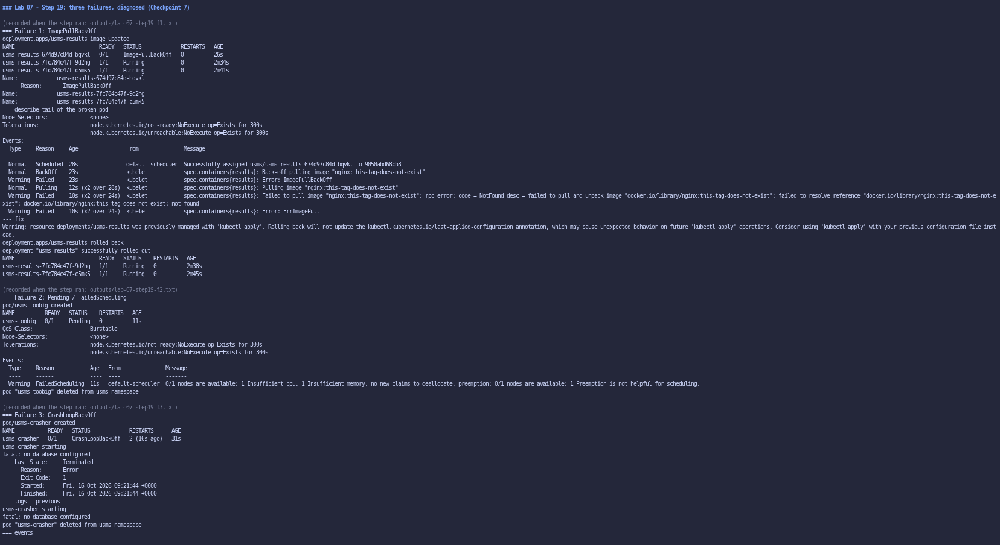

 

#### Step 20: ECS and EKS side by side

The ECS service (`usms-enrolment:2`, 2/2, 1 load balancer, 1 deployment) and the three EKS Deployments were captured together. The eight-row comparison table and my choice (ECS on Fargate for USMS) are in the notes.

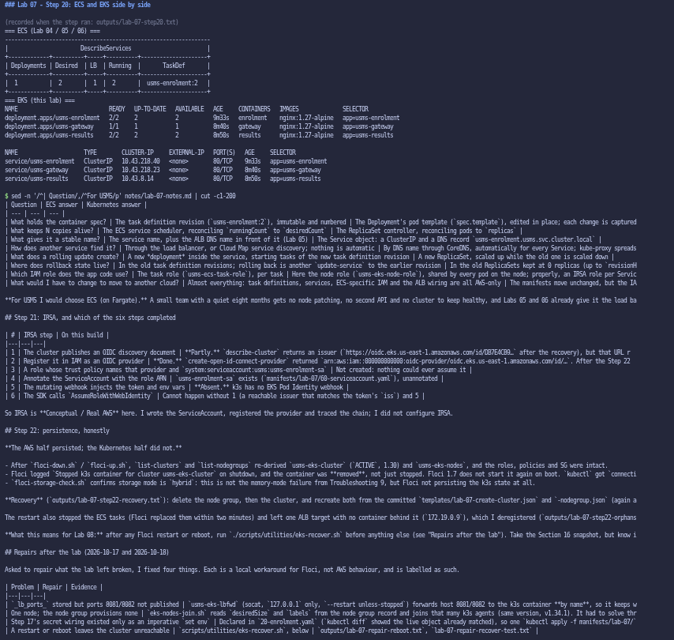
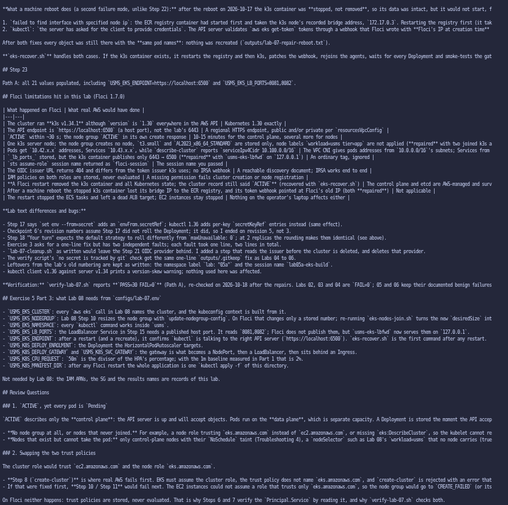
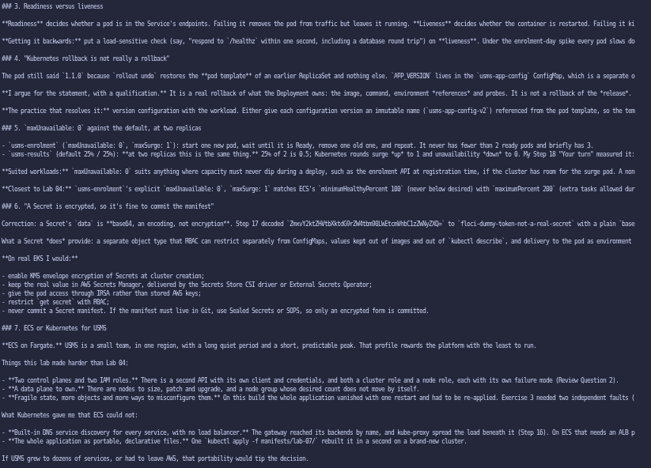

 

#### Step 21: IRSA

The cluster publishes an issuer URL, and `create-open-id-connect-provider` registered it in IAM. However:

- that URL returns **HTTP 404** from AWS's OIDC host;
- k3s signs ServiceAccount tokens as `https://kubernetes.default.svc.cluster.local`;
- there is no pod-identity webhook.

So only steps 1 and 2 of IRSA's six completed, and only in form. `usms-enrolment-sa` was created from `60-serviceaccount.yaml`, and IRSA is recorded as Conceptual / Real AWS. After the Step 22 recreate, the stale provider was replaced with one for the new issuer.

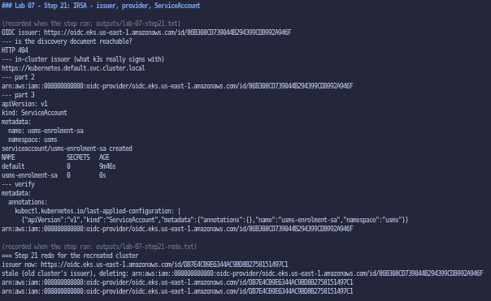

 

#### Step 22: Restart persistence (Checkpoint 8)

After `floci-down.sh` and `floci-up.sh`:

- **The AWS half persisted.** `list-clusters` and `list-nodegroups` re-derived `usms-eks-cluster` (`ACTIVE`, 1.30) and `usms-eks-nodes`.
- **The Kubernetes half did not.** Floci *removed* the k3s container on shutdown and did not start it again, and the k3s datastore lived only inside it. `kubectl` got `connection refused` on `:6500`, and the diff shows every Deployment and Service missing.

**`PERSISTENCE PROVEN` was therefore not achieved for the Kubernetes objects.** The storage mode is `hybrid`, so this is a Floci 1.7 limitation, not a memory-mode mistake.

**Recovery:**

1. Deleted the node group and the cluster, then recreated both from the committed templates.
2. Ran `kubectl apply -f manifests/lab-07/`, which rebuilt all 13 objects in **1.0 s**.
3. Re-ran Step 17's imperative `set env`, the one thing no manifest held.

The new diff shows only the three ClusterIPs changed; the gateway, which uses names, did not notice. The restart also replaced the ECS tasks, and I deregistered one ALB target with no container behind it. Step 17's secret wiring has since been declared in `20-enrolment.yaml`, so step 3 is no longer needed, and `eks-recover.sh` now does the whole recovery in one command.

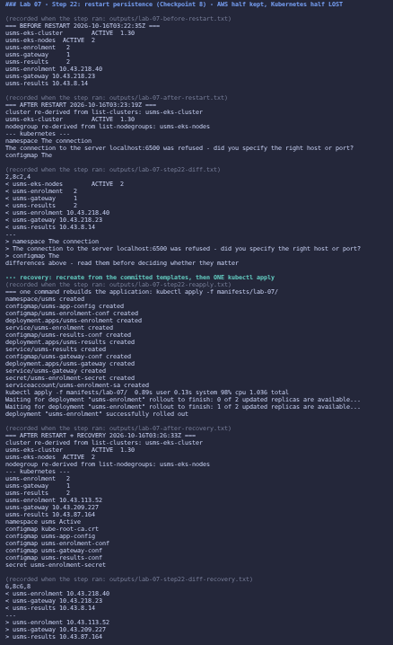

 

#### Step 23: `configs/lab-07.env`

`all values populated` (Path A): **21** exports, `lb_ports=8081,8082`, endpoint `https://localhost:6500`.

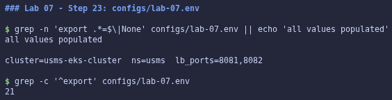

 

#### Step 24: Commit (Checkpoint 9)

`git status --short` showed nothing under `outputs/`, and `git check-ignore -v outputs/lab-07-support-probe.txt` named `.gitignore:8:outputs/*`. The commit lists explicit paths. Afterwards `git ls-files | grep -c '^outputs/'` counts only the deliberate `outputs/.gitkeep`.

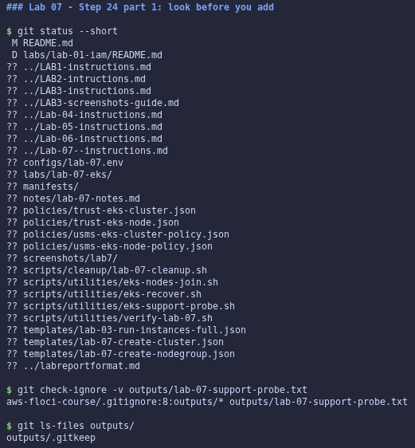
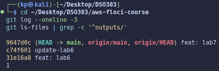

 

#### Section 8.1: `verify-lab-07.sh`

Built verbatim from the lab, with the same one-line `outputs/.gitkeep` fix as Labs 04 to 06. Result: **`PASS=30 FAIL=0`**. The smoke test returned three JSON documents and `SMOKE TEST PASSED`.

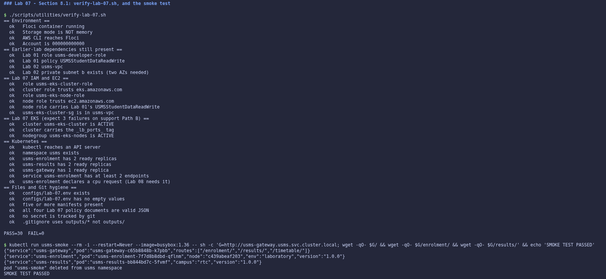

 

#### Section 8.2: `lab-07-cleanup.sh`

Built from the lab, plus two additions. It reads the cluster's OIDC issuer before deleting the cluster, and deletes the provider Step 21 registered, which the lab's version would leave behind. It also removes the local containers added by the repairs (`usms-eks-node-*`, `usms-eks-lbfwd`). `bash -n` passes, and the script was **not** run.

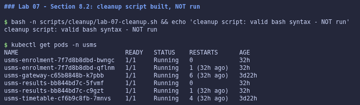

 

#### Repairs after the lab

After the lab I repaired the problems Floci had left. Each is a local workaround, not AWS behaviour.

| Problem | Repair | Result |
|---|---|---|
| `_lb_ports_` stored, but ports 8081/8082 not published | `usms-eks-lbfwd`, a socat container on `127.0.0.1` only, forwards them to the k3s container by name | `curl localhost:8081/` reached a test LoadBalancer Service |
| One node; the node group provisions none | `scripts/utilities/eks-nodes-join.sh` joins `desiredSize` k3s agents, labelled from the node group record. On the way it needed the host's inotify limit raised (`sudo sysctl fs.inotify.max_user_instances=512`), stale node-password secrets cleared, and images copied from the server node's cache | 3 nodes Ready; pods spread across them; 12 requests answered by both agents |
| Step 17's `set env` was not in any manifest | Declared in `20-enrolment.yaml` (the live object already matched) | One `kubectl apply` restores everything |
| A machine reboot left k3s stopped. The ECR registry had taken its node IP, and its token webhook pointed at Floci's old IP (`provide credentials`) | Restart the registry first, then k3s; point the webhook at `http://floci.:4566` (container name) | All objects survived with the same pod names; nothing was recreated |
| Any restart or reboot | `scripts/utilities/eks-recover.sh`: restarts in place if the container exists, otherwise recreates from the templates and manifests | A simulated reboot recovered in **64 s** with `SMOKE TEST PASSED` |

The reboot also stopped the Lab 03 instances again and left two dead ALB targets. I started the instances, deregistered only the targets with no task behind them, and web-01 got HTTP 200 through the ALB. On 2026-10-18 every verifier was back at its baseline: 02/03/04/07 `FAIL=0`, 05 and 06 with their benign 2 and 3.

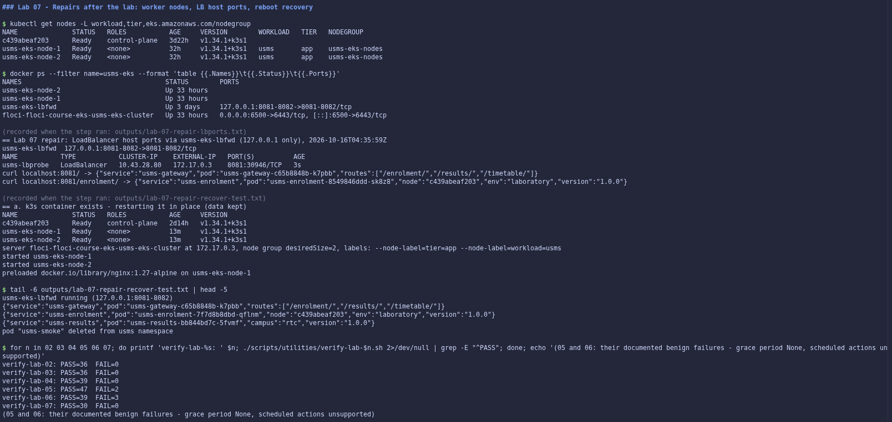

 

#### Independent exercises

All five are documented in `labs/lab-07-eks/exercises.md`:

1. `usms-timetable` (one file, three objects, requests declared), reached by DNS.
2. A `/timetable/` gateway route. `apply` alone did not roll; `rollout restart` made revision 2, and all three routes answered in one command.
3. Two independent faults found with commands: the `version: v2` selector, and a readiness probe on a path stock nginx does not serve (404). Each was a one-line fix, two endpoints resulted, and `usms-broken` was deleted.
4. A `topologySpreadConstraints` (advisory) and a `PodDisruptionBudget` (enforced). On Floci's single node, the drain was **refused by the PDB** at the last pod (45 of 45 requests succeeded). After the repair to three nodes, a **whole-node drain completed**. It lost 1 request in 75 to the endpoint-propagation race; a `preStop` sleep of 5 s fixed that, giving **75 of 75**.
5. The metrics API is present, and the idle CPU is 1m = **2 %** of the 50m request. The policy was traced from IAM: three holders, bucket ARN against object ARN, and the bucket does not exist. The Lab 08 variables are in the notes.

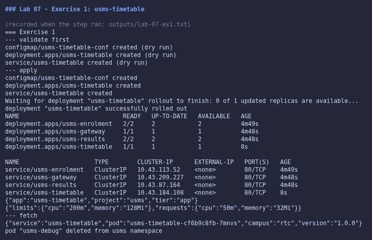
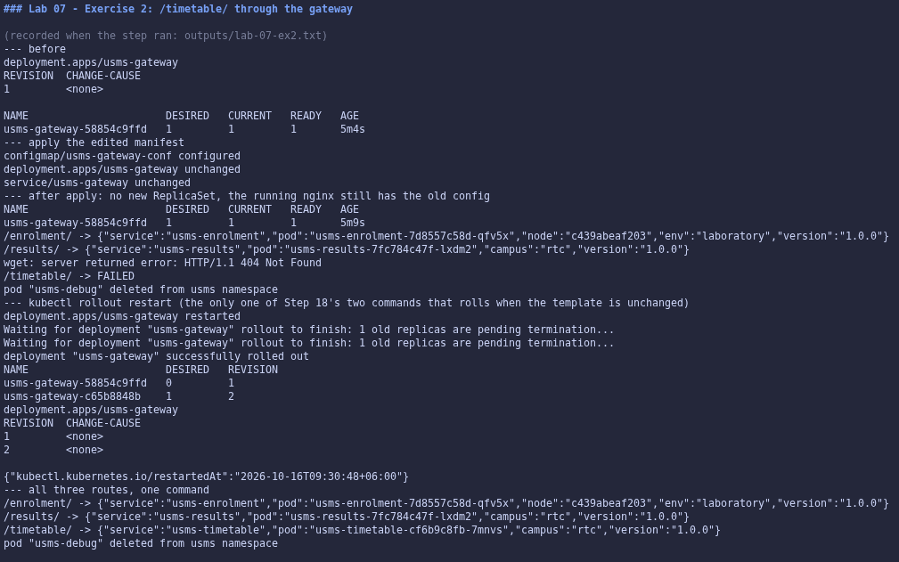
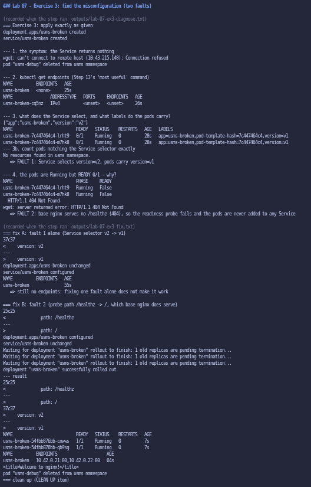
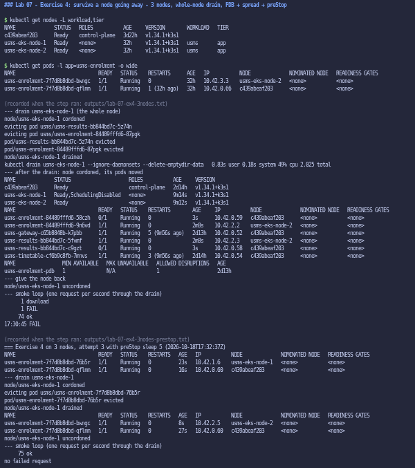
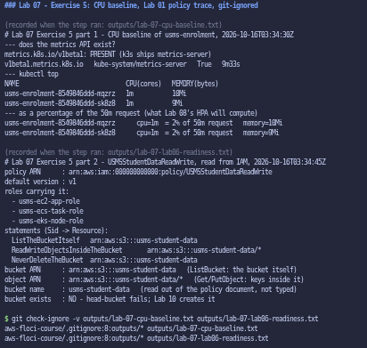

---

## 6. Results and Evidence

### 6.1 CLI Output

**Screenshot 1: the cluster and node group `ACTIVE` (Checkpoint 3, Step 10)**

*Image Source: `aws-floci-course/screenshots/lab7/s10.png`*

 

**Screenshot 2: DNS discovery and load spreading through the gateway (Checkpoint 5, Step 16)**

*Image Source: `aws-floci-course/screenshots/lab7/s16.png`*

 

**Screenshot 3: the restart, and the one-command recovery (Checkpoint 8, Step 22)**

*Image Source: `aws-floci-course/screenshots/lab7/s22.png`*

 

**Screenshot 4: `verify-lab-07.sh` and the smoke test (Section 8.1)**

*Image Source: `aws-floci-course/screenshots/lab7/s25.png`*

 

All screenshots referenced in Section 5 are stored in `aws-floci-course/screenshots/lab7/`.

### 6.2 AWS Console Verification

Not applicable. Floci is a CLI-only emulator with no web console.

---

## 7. Analysis and Discussion

The application is complete and verified:

- an EKS cluster and node group in Lab 02's VPC with separate roles;
- three microservices (four with Exercise 1) reachable from each other by name;
- a rolling update, a rollback, and three diagnosed failures;
- a Secret shown to be base64;
- `configs/lab-07.env` with 21 populated values.

`verify-lab-07.sh` reports `PASS=30 FAIL=0`. Labs 02 to 04 are `FAIL=0`, and Labs 05 and 06 keep their documented benign failures.

The lab separates what I **observed**, what was only **recorded**, and what is **conceptual**:

- **Observed:** the Kubernetes object model, DNS discovery, kube-proxy spreading, rollouts and rollbacks, probes, the three failure modes, the eviction API honouring a PDB, and the metrics API.
- **Recorded only:** IAM policies (never evaluated), node group sizing and instance type (Floci provisioned no node; the two worker nodes are agents I joined from the record), the security group, and the `_lb_ports_` tag (Floci does not publish its ports; my forwarder does).
- **Conceptual:** IRSA (a provider registered against an issuer nothing serves), KMS encryption of Secrets, access entries, and control-plane logging.

The most important finding was **Step 22**. Floci keeps the cluster *record* across a restart but discards the cluster itself, so the AWS API claimed `ACTIVE` for a cluster that no longer existed. I reported it as a failure of persistence rather than smoothing it over. The recovery became the lab's best demonstration of declarative configuration: a brand-new cluster was running the whole application one `kubectl apply` later. The one gap was an imperative command, which argues for keeping *everything* in the manifests.

Issues encountered and how each was resolved:

- **Endpoint on port 6500 and k8s 1.34:** recorded; nothing depended on 6443.
- **One node:** recorded, then repaired with two joined agent nodes, so Exercise 4 was demonstrated on both one node and three.
- **LB ports not published:** repaired with a localhost-only forwarder.
- **A machine reboot** broke the cluster differently from Step 22: a stolen bridge IP and a webhook pointing at Floci's old IP. Both were fixed in place, and `eks-recover.sh` now handles both cases.
- **Kubernetes state lost on restart:** the cluster was recreated from committed templates and the manifests re-applied. The ECS restart artefacts were repaired: one dead ALB target deregistered, EC2 instances restarted.
- **Stale OIDC provider** after the recreate: deleted, and the new issuer registered. The cleanup script now removes it at the end of the course.
- **Lab-text differences** found by testing:
  - `set env` writes `secretKeyRef`, not `envFrom`;
  - the revision numbers in Checkpoint 6;
  - the default strategy equals `maxUnavailable: 0` at two replicas;
  - Exercise 3's "one line" for two faults;
  - the verifier's `.gitkeep` false positive.

---

## 8. Reflection

**1. What did you learn about this AWS service?**

That EKS is two systems joined by IAM. `aws eks` creates a control plane and records capacity; `kubectl` talks to a different endpoint in a different language. On real AWS the two meet through the roles, access entries and IRSA. I learned the Kubernetes model by using it:

- a Deployment owns ReplicaSets, which own pods;
- a Service selects pods by label and only includes Ready ones;
- `rollout undo` reverts the pod template and nothing else;
- a Secret is only base64;
- a PodDisruptionBudget is enforced by the eviction API, not by goodwill.

**2. What challenges did you encounter?**

Telling the two halves apart when something failed. The biggest challenge was Step 22: every AWS call said the cluster was healthy while `kubectl` could not connect, because the k3s container had been deleted. Working out that the datastore was never persisted, rather than suspecting my storage mode, took reading Floci's logs and its data directory. Exercise 3 was also instructive: fixing the obvious selector fault changed nothing visible, which is exactly why it had to be diagnosed with commands, not by reading YAML.

**3. How would you apply this service in a real-world cloud environment?**

For a team running many services, or needing portability, I would use EKS with:

- managed node groups across two AZs in private subnets;
- every workload declared in Git and applied by a pipeline, never by hand;
- requests on every container, readiness probes on dependencies, and liveness only for a genuinely wedged process;
- a PDB and topology spread on anything user-facing;
- IRSA (or EKS Pod Identity) per ServiceAccount instead of node-role permissions;
- KMS envelope encryption and an external secrets manager instead of committed Secrets.

For USMS itself I would stay on ECS Fargate, for the reasons in Review Question 7.

**4. What additional concepts or features would you like to explore?**

The HorizontalPodAutoscaler, NodePort, LoadBalancer and Ingress (Lab 08); the Cluster Autoscaler or Karpenter, so that node group capacity actually moves; NetworkPolicies, since a namespace is not an isolation boundary; EKS Pod Identity against IRSA; and Helm or Kustomize for versioning configuration together with the workload.

---

## 9. Conclusion

The objectives were achieved on support path A:

- `usms-eks-cluster` (four Lab 02 subnets, `_lb_ports_` tagged) and `usms-eks-nodes` (private subnets, 2/4/2) exist with their own roles, and Lab 01's policy is on the node role;
- three USMS microservices run in namespace `usms`, discover each other by DNS and spread load across replicas;
- a rolling update, a rollback and three failure diagnoses were performed, and a ConfigMap and a Secret were used, with the Secret shown to be base64;
- `configs/lab-07.env` records 21 identifiers for Lab 08.

Persistence across a Floci restart was proven for the AWS half and **disproven** for the Kubernetes half, and the application was recovered declaratively. A machine reboot, by contrast, keeps the Kubernetes data, and it was recovered in place. `eks-recover.sh` handles both cases. The cluster now has the node group's two worker nodes, and `localhost:8081-8082` reaches LoadBalancer Services, ready for Lab 08. IRSA was traced but cannot work on this build.

Key concepts learned: the control plane / data plane split; the two IAM roles and their trust principals; Deployments, ReplicaSets, Services, ConfigMaps and Secrets; readiness against liveness; rolling update strategy arithmetic; rollback's limits; PDBs and topology spread. Skills developed include writing and validating manifests, diagnosing with `get` → `describe` → `logs` and `get endpoints`, separating what an emulator proves from what it only records, and recovering an environment from committed files.

---

## 10. Appendix

| Item | Path |
|---|---|
| Kubernetes manifests | `aws-floci-course/manifests/lab-07/` (`00-namespace` … `70-timetable`) |
| Trust and permissions policies | `aws-floci-course/policies/trust-eks-cluster.json`, `trust-eks-node.json`, `usms-eks-cluster-policy.json`, `usms-eks-node-policy.json` |
| Request bodies | `aws-floci-course/templates/lab-07-create-cluster.json`, `lab-07-create-nodegroup.json` |
| Generated names and ARNs | `aws-floci-course/configs/lab-07.env` |
| Exercises write-up | `aws-floci-course/labs/lab-07-eks/exercises.md` |
| Lab 08 readiness file | `aws-floci-course/labs/lab-07-eks/lab08-readiness.txt` |
| Notes, support path, comparison table, limitations, review questions | `aws-floci-course/notes/lab-07-notes.md` |
| Scripts | `aws-floci-course/scripts/utilities/verify-lab-07.sh`, `eks-support-probe.sh`, `eks-nodes-join.sh`, `eks-recover.sh` |
| Cleanup script (not run) | `aws-floci-course/scripts/cleanup/lab-07-cleanup.sh` |
| Evidence files (git-ignored) | `aws-floci-course/outputs/lab-07-*` |
| All screenshots | `aws-floci-course/screenshots/lab7/` |

---

## Submission Checklist

- [x] Student information completed
- [x] Objectives stated
- [x] Introduction provided
- [x] Real-world use case described
- [x] Tools listed
- [x] System design included
- [x] Implementation documented
- [x] CLI outputs included
- [ ] Console screenshots attached *(not applicable: Floci is CLI-only, no web console)*
- [x] Analysis completed
- [x] Reflection completed
- [x] Conclusion written
- [x] Appendix attached
